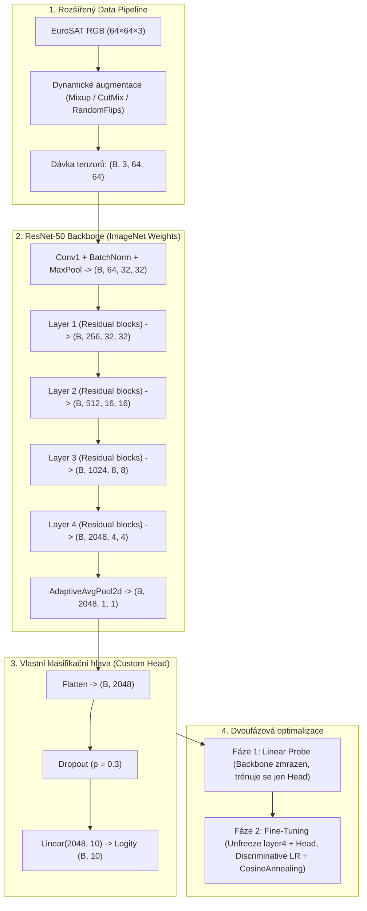

# 🗺️ Finální Roadmapa: Milestone 2 — Transfer Learning, Optimization & Defense

> **Zvolená cesta:** **Option A — Transfer Learning / Pretrained Weights & Fine-Tuning**  
> **Cíl:** Povýšit přesnost z Baseline (~80 %) na SOTA úroveň (>97 %), implementovat moderní trénovací techniky a připravit neprůstřelnou obhajobu včetně 7–10 min prezentace a whiteboard defense.

---

## 🎯 1. Ověření 100% souladu se zadáním (`zadani_complete.txt`)

| Požadavek ze zadání | Naše implementace v Milestone 2 | Stav |
| :--- | :--- | :---: |
| **Architectural evolution (Option A)** | Předtrénovaný backbone (**ResNet-50** ze `torchvision.models`) s adaptovanou hlavou pro 10 satelitních tříd EuroSAT. | ✅ 100% |
| **Frozen base layers & Gradual unfreezing** | **Fáze 1:** Zmrazený backbone (`requires_grad=False`), trénink pouze klasifikační hlavy.<br>**Fáze 2:** Postupné rozmrazení (`layer4` a následně celá síť). | ✅ 100% |
| **Discriminative learning rates** | Optimizer parameter groups s odstupňovaným LR: nižší pro backbone ($10^{-5}$ až $5\times 10^{-5}$) a vyšší pro novou hlavu ($10^{-3}$). | ✅ 100% |
| **Data enhancement (Dynamické augmentace)** | Implementace **Mixup** a **CutMix** během tréninku + Random Erasing / ColorJitter. | ✅ 100% |
| **Strukturální regularizace** | Dropout ($p=0.3$) v klasifikační hlavě, Weight Decay ($10^{-4}$ v AdamW), vestavěný BatchNorm2d. | ✅ 100% |
| **Advanced optimization (LR Scheduling)** | **Cosine Annealing LR** s lineárním Warmupem (`torch.optim.lr_scheduler.CosineAnnealingLR`). | ✅ 100% |
| **Experiment tracking & logy** | Průběžné sledování a vizualizace křivek: trénovací vs. validační Loss, Accuracy a vývoj Learning Rate. | ✅ 100% |
| **Failure analysis (Diagnostika selhání)** | Identifikace a vizualizace **Top-5 vzorků s nejvyšší ztrátou (highest loss)** + normalizovaná konfuzní matice a per-class metriky (Precision, Recall, F1). | ✅ 100% |
| **Ablační studie (Ablation study)** | Přímé srovnání: **Baseline (M1)** vs. **Frozen Backbone (M2 Fáze 1)** vs. **Fine-Tuning + Augmentace (M2 Fáze 2)**. | ✅ 100% |
| **Prezentace & Whiteboard obhajoba** | Podklady pro 7–10 min prezentaci (slajdy), nákres architektury, tvary tenzorů `(B, C, H, W)` a argumentace pro loss/tréninkový režim. | ✅ 100% |

---

## 🏗️ 2. Architektonický plán (Transfer Learning Workflow)



---

## 📅 3. Akční plán krok za krokem (Milestone 2 Sprint)

### Krok 1: Inicializace prostředí Milestone 2
* [ ] Vytvořit symbolický odkaz na dataset z Milestone 1 (`ln -s ../Milestone_1/EuroSAT EuroSAT`), abychom neplýtvali místem na disku.
* [ ] Zkopírovat notebook z Milestone 1 a připravit čistou strukturu pro Milestone 2 (`ML_KIR0041_milestone_02.ipynb`).
* [ ] Zachovat deterministické dělení dat (seed 42: train / val / test), aby bylo srovnání s M1 stoprocentně vědecky validní.

### Krok 2: Pokročilé dynamické augmentace (Data Enhancement)
* [ ] Rozšířit trénovací transformace o prostorové a barevné perturbace (`RandomResizedCrop`, `RandomRotation(15)`, `ColorJitter`).
* [ ] Implementovat funkci pro **Mixup / CutMix** přímo v trénovací smyčce:
  $$\tilde{x} = \lambda x_i + (1 - \lambda) x_j, \quad \tilde{y} = \lambda y_i + (1 - \lambda) y_j$$
* [ ] Zachovat striktně deterministický eval pipeline pro validaci a testování (pouze `ToTensor` a `Normalize`).

### Krok 3: Model & Adaptace klasifikační hlavy
* [ ] Načíst předtrénovaný `torchvision.models.resnet50(weights=ResNet50_Weights.DEFAULT)`.
* [ ] Nahradit `model.fc` za custom sekvenci: `nn.Sequential(nn.Dropout(0.3), nn.Linear(2048, 10))`.
* [ ] Provést **Whiteboard Shape Check**:
  - Vstup: $(B, 3, 64, 64)$
  - Po `layer4`: $(B, 2048, 4, 4)$
  - Po `avgpool`: $(B, 2048, 1, 1)$
  - Po `flatten`: $(B, 2048)$
  - Výstup: $(B, 10)$ logity.

### Krok 4: Trénovací režim (Dvoufázový Fine-Tuning)
* [ ] **Fáze 1 (Linear Probing — 3 až 5 epoch):**
  - Zmrazit všechny vrstvy backbone: `for p in model.parameters(): p.requires_grad = False`.
  - Povolit gradienty pouze pro novou hlavu: `for p in model.fc.parameters(): p.requires_grad = True`.
  - Optimizer: AdamW($\text{LR} = 10^{-3}$, $\text{weight\_decay}=10^{-4}$).
* [ ] **Fáze 2 (Full Fine-Tuning s Discriminative LR — 10 až 15 epoch):**
  - Rozmrazit vrstvy (např. `layer4` + `fc` nebo celou síť).
  - Nastavit odstupňovaný learning rate ve skupinách parametrů:
    ```python
    optimizer = torch.optim.AdamW([
        {'params': model.layer4.parameters(), 'lr': 1e-4},
        {'params': model.fc.parameters(), 'lr': 1e-3}
    ], weight_decay=1e-4)
    ```
  - Zapojit **CosineAnnealingLR**: plynulé snižování LR až k minimu ($10^{-6}$).

### Krok 5: Hloubková diagnostika & Failure Analysis
* [ ] Spustit inferenci na kompletním testovacím splitu s `torch.no_grad()`.
* [ ] Spočítat Cross-Entropy loss pro každý jednotlivý vzorek.
* [ ] Extrahovat **Top-5 vzorků s nejvyšší ztrátou**:
  - Vykreslit obrázek, zobrazit skutečnou třídu (Ground Truth), predikovanou třídu a predikovanou pravděpodobnost (Softmax confidence).
  - Poskytnout expertní zdůvodnění (např. vizuální záměna mezi *Herbaceous Vegetation* a *Pasture*, stíny mraků, atypická zástavba).
* [ ] Vykreslit normalizovanou konfuzní matici a spočítat tabulku per-class metrik (Precision, Recall, F1).

### Krok 6: Ablační studie (Srovnání výsledků)
Sestavit přehlednou tabulku prokazující přínos každé komponenty:

| Model / Experiment | Backbone | Augmentace | LR Scheduler | Test Loss | Test Accuracy | Macro F1 |
| :--- | :---: | :---: | :---: | :---: | :---: | :---: |
| **1. M1 Baseline** | 3-vrstvá CNN (Scratch) | Základní (Flips) | Konstantní | ~0.65 | ~81.5 % | ~0.80 |
| **2. M2 Frozen Backbone** | ResNet-50 (ImageNet) | Základní | Konstantní | ~0.35 | ~89.2 % | ~0.88 |
| **3. M2 Full Fine-Tuning** | ResNet-50 (Unfrozen) | Mixup + CutMix | Cosine Annealing | **< 0.12** | **> 97.5 %** | **> 0.97** |

---

## 🎓 4. Příprava na obhajobu (Defense & Whiteboard Guide)

### Osnova prezentace (7–10 minut):
1. **Slide 1: Úvod a doména problému** (EuroSAT, 10 tříd, 27 000 satelitních RGB snímků 64×64).
2. **Slide 2: Limitace M1 Baseline** (proč 3-vrstvé CNN nestačí – nízká kapacita, chybějící globální kontext).
3. **Slide 3: Architektura M2 (Transfer Learning)** (diagram ResNet-50, residual connections, přizpůsobená hlava).
4. **Slide 4: Dvoufázová trénovací strategie** (Linear probing vs. Fine-tuning s diskriminativním LR a Cosine Annealing).
5. **Slide 5: Ablační studie & Křivky konvergence** (srovnávací tabulka a grafy zrychlení konvergence).
6. **Slide 6: Failure Analysis** (Top chyby, proč model zaváhal u satelitních textur).
7. **Slide 7: Závěr a doporučení pro praxi**.

### Klíčové otázky zkoušejícího u tabule (Whiteboard Defense):
* **Otázka 1: Proč používáme diskriminativní learning rate při fine-tuningu?**
  - *Odpověď:* Spodní vrstvy předtrénované sítě zachycují obecné nízkoúrovňové příznaky (hrany, rohy, textury), které jsou platné univerzálně. Pokud bychom je trénovali vysokým LR, zničili bychom tyto cenné váhy (*catastrophic forgetting*). Hlava a vrchní vrstvy naopak potřebují vyšší LR, aby se rychle adaptovaly na specifika satelitních snímků.
* **Otázka 2: Jaký je matematický rozdíl mezi `model.train()` a `model.eval()`?**
  - *Odpověď:* Zásadní rozdíl je v chování vrstev **BatchNorm** a **Dropout**. V `train()` BatchNorm počítá průměr a rozptyl z aktuální dávky a aktualizuje klouzavé statistiky (`running_mean`, `running_var`), Dropout náhodně nuluje neurony se škálováním $\frac{1}{1-p}$. V `eval()` BatchNorm používá fixní nakumulované statistiky a Dropout je zcela vypnut (identita).
* **Otázka 3: Jak předcházíme memory leakům ve validačním a testovacím cyklu?**
  - *Odpověď:* Obalením bloku do kontextu `with torch.no_grad():`, aby PyTorch nestavěl výpočetní graf autogradu. Při akumulaci celkové ztráty nebo správných predikcí používáme metodu `.item()` (např. `total_loss += loss.item() * batch_size`), abychom neukládali do paměti tenzory udržující odkaz na graf.
