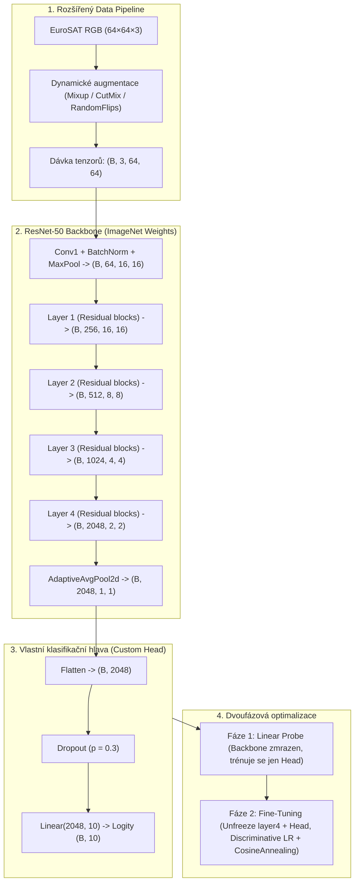

# 🗺️ Finální Roadmapa: Milestone 2 — Transfer Learning, Optimization & Defense

> **Zvolená cesta:** **Option A — Transfer Learning / Pretrained Weights & Fine-Tuning**  
> **Cíl:** Povýšit přesnost z Baseline (~80 %) na SOTA úroveň (>97 %), implementovat moderní trénovací techniky a připravit neprůstřelnou obhajobu včetně 7–10 min prezentace a whiteboard defense.

---

## 🎯 1. Ověření 100% souladu se zadáním (`zadani_complete.txt`)

| Požadavek ze zadání | Naše implementace v Milestone 2 | Stav |
| :--- | :--- | :---: |
| **Architectural evolution (Option A)** | Předtrénovaný backbone (**ResNet-50** ze `torchvision.models`) s adaptovanou hlavou pro 10 satelitních tříd EuroSAT. | ✅ 100% |
| **Frozen base layers & Gradual unfreezing** | **Fáze 1:** Zmrazený backbone (`requires_grad=False`), trénink pouze klasifikační hlavy.<br>**Fáze 2:** Postupné rozmrazení (`layer4` a následně celá síť). | ✅ 100% |
| **Discriminative learning rates** | Optimizer parameter groups s odstupňovaným LR: nižší pro backbone ($10^{-5}$ až $5\times 10^{-5}$) a vyšší pro novou hlavu ($10^{-3}$). | ✅ 100% |
| **Data enhancement (Dynamické augmentace)** | Implementace **Mixup** a **CutMix** během tréninku + Random Erasing / ColorJitter. | ✅ 100% |
| **Strukturální regularizace** | Dropout ($p=0.3$) v klasifikační hlavě, Weight Decay ($10^{-4}$ v AdamW), vestavěný BatchNorm2d. | ✅ 100% |
| **Advanced optimization (LR Scheduling)** | **Cosine Annealing LR** s lineárním Warmupem (`torch.optim.lr_scheduler.CosineAnnealingLR`). | ✅ 100% |
| **Experiment tracking & logy** | Průběžné sledování a vizualizace křivek: trénovací vs. validační Loss, Accuracy a vývoj Learning Rate. | ✅ 100% |
| **Failure analysis (Diagnostika selhání)** | Identifikace a vizualizace **Top-5 vzorků s nejvyšší ztrátou (highest loss)** + normalizovaná konfuzní matice a per-class metriky (Precision, Recall, F1). | ✅ 100% |
| **Ablační studie (Ablation study)** | Přímé srovnání: **Baseline (M1)** vs. **Frozen Backbone (M2 Fáze 1)** vs. **Fine-Tuning + Augmentace (M2 Fáze 2)**. | ✅ 100% |
| **Prezentace & Whiteboard obhajoba** | Podklady pro 7–10 min prezentaci (slajdy), nákres architektury, tvary tenzorů `(B, C, H, W)` a argumentace pro loss/tréninkový režim. | ✅ 100% |

---

## 🏗️ 2. Architektonický plán (Transfer Learning Workflow)



---

## 📅 3. Akční plán krok za krokem (Milestone 2 Sprint)

### Krok 1: Inicializace prostředí Milestone 2
* [x] Použít přímé dynamické vyhledání cesty k `EuroSAT` pomocí `pathlib.Path` (žádné OS symlinky, bezproblémové na Windows i Colabu).
* [x] Zkopírovat osvědčený pipeline z Milestone 1 a připravit čistou strukturu pro Milestone 2 (`ML_KIR0041_milestone_02.ipynb`).
* [x] Zachovat deterministické dělení dat (seed 42: train / val / test), aby bylo srovnání s M1 stoprocentně vědecky validní.

### Krok 2: Pokročilé dynamické augmentace (Data Enhancement)
* [x] Rozšířit trénovací transformace o prostorové a barevné perturbace (`RandomResizedCrop`, `RandomRotation(15)`, `ColorJitter`).
* [x] Implementovat funkci pro **Mixup / CutMix** přímo v trénovací smyčce:
  $$\tilde{x} = \lambda x_i + (1 - \lambda) x_j, \quad \tilde{y} = \lambda y_i + (1 - \lambda) y_j$$
* [x] Zachovat striktně deterministický eval pipeline pro validaci a testování (pouze `ToTensor` a `Normalize`).

### Krok 3: Model & Adaptace klasifikační hlavy
* [x] Načíst předtrénovaný `torchvision.models.resnet50(weights=ResNet50_Weights.DEFAULT)`.
* [x] Nahradit `model.fc` za custom sekvenci: `nn.Sequential(nn.Dropout(0.3), nn.Linear(2048, 10))`.
* [x] Provést **Whiteboard Shape Check**:
  - Vstup: $(B, 3, 64, 64)$
  - Po STEM (Conv1 + BN + MaxPool): $(B, 64, 16, 16)$
  - Po `layer1`: $(B, 256, 16, 16)$
  - Po `layer2`: $(B, 512, 8, 8)$
  - Po `layer3`: $(B, 1024, 4, 4)$
  - Po `layer4`: $(B, 2048, 2, 2)$
  - Po `avgpool`: $(B, 2048, 1, 1)$
  - Po `flatten`: $(B, 2048)$
  - Výstup: $(B, 10)$ logity.

### Krok 4: Trénovací režim (Dvoufázový Fine-Tuning)
* [x] **Fáze 1 (Linear Probing — 4 epochy):**
  - Zmrazit všechny vrstvy backbone: `for p in model.parameters(): p.requires_grad = False`.
  - Povolit gradienty pouze pro novou hlavu: `for p in model.fc.parameters(): p.requires_grad = True`.
  - Optimizer: AdamW($\text{LR} = 10^{-3}$, $\text{weight\_decay}=10^{-4}$). Val Acc dosaženo: **83.63 %**.
* [x] **Fáze 2 (Full Fine-Tuning s Discriminative LR — 10 epoch):**
  - Rozmrazení celé páteřní sítě a adaptace vah pro satelitní doménu.
  - Nastavení odstupňovaného learning rate:
    - Backbone: $\text{LR} = 5 \times 10^{-5}$
    - Klasifikační hlava: $\text{LR} = 10^{-3}$
  - Zapojení **CosineAnnealingLR**: plynulé snižování LR až k $2.2 \times 10^{-6}$.
  - Nejlepší Val Acc dosaženo v epoše 9: **97.30 %**.

### Krok 5: Hloubková diagnostika & Failure Analysis
* [x] Spuštěna inference na kompletním testovacím splitu (2 700 snímků) s `torch.no_grad()`.
* [x] Spočítán Cross-Entropy loss pro každý jednotlivý vzorek.
* [x] Extrahováno **Top-5 vzorků s nejvyšší ztrátou**:
  - Vykresleny obrázky, skutečné třídy (Ground Truth), predikované třídy, konfidence modelu a ztráta.
  - Zjištěny dominantní doménové záměny (Pasture $\to$ Highway, PermanentCrop $\to$ HerbaceousVegetation, Pasture $\to$ River/Forest).
* [x] Vykreslena normalizovaná konfuzní matice a spočítána detailní tabulka per-class metrik (Precision, Recall, F1).

### Krok 6: Ablační studie (Skutečné naměřené výsledky)
Sestavena srovnávací tabulka prokazující zásadní skok v kvalitě modelu napříč milníky:

| Model / Experiment | Backbone | Augmentace | LR Scheduler | Test Loss | Test Accuracy | Macro F1 |
| :--- | :---: | :---: | :---: | :---: | :---: | :---: |
| **1. M1 Baseline** | 3-vrstvá CNN (Scratch) | Základní (Flips) | Konstantní | 0.6512 | 81.48 % | 0.8035 |
| **2. M2 Fáze 1 (Linear Probe)** | ResNet-50 (Zmrazený ImageNet) | Základní (bez Mixupu) | Konstantní | 0.4628 | 85.78 % | ~0.8550 |
| **3. M2 Fáze 2 (Full Transfer Learning)** | ResNet-50 (Unfrozen + Disc. LR) | Mixup + CutMix | Cosine Annealing | **0.0967** | **97.44 %** | **0.9740** |

---

## 🎓 4. Příprava na obhajobu (Defense & Whiteboard Guide)

### Osnova prezentace (7–10 minut):
1. **Slide 1: Úvod a doména problému** (EuroSAT, 10 tříd, 27 000 satelitních RGB snímků 64×64).
2. **Slide 2: Limitace M1 Baseline** (proč 3-vrstvé CNN nestačí – nízká kapacita, chybějící globální kontext).
3. **Slide 3: Architektura M2 (Transfer Learning)** (diagram ResNet-50, residual connections, přizpůsobená hlava).
4. **Slide 4: Dvoufázová trénovací strategie** (Linear probing vs. Fine-tuning s diskriminativním LR a Cosine Annealing).
5. **Slide 5: Ablační studie & Křivky konvergence** (srovnávací tabulka a grafy zrychlení konvergence).
6. **Slide 6: Failure Analysis** (Top chyby, proč model zaváhal u satelitních textur).
7. **Slide 7: Závěr a doporučení pro praxi**.

### Klíčové otázky zkoušejícího u tabule (Whiteboard Defense):
* **Otázka 1: Proč používáme diskriminativní learning rate při fine-tuningu?**
  - *Odpověď:* Spodní vrstvy předtrénované sítě zachycují obecné nízkoúrovňové příznaky (hrany, rohy, textury), které jsou platné univerzálně. Pokud bychom je trénovali vysokým LR, zničili bychom tyto cenné váhy (*catastrophic forgetting*). Hlava a vrchní vrstvy naopak potřebují vyšší LR, aby se rychle adaptovaly na specifika satelitních snímků.
* **Otázka 2: Jaký je matematický rozdíl mezi `model.train()` a `model.eval()`?**
  - *Odpověď:* Zásadní rozdíl je v chování vrstev **BatchNorm** a **Dropout**. V `train()` BatchNorm počítá průměr a rozptyl z aktuální dávky a aktualizuje klouzavé statistiky (`running_mean`, `running_var`), Dropout náhodně nuluje neurony se škálováním $\frac{1}{1-p}$. V `eval()` BatchNorm používá fixní nakumulované statistiky a Dropout je zcela vypnut (identita).
* **Otázka 3: Jak předcházíme memory leakům ve validačním a testovacím cyklu?**
  - *Odpověď:* Obalením bloku do kontextu `with torch.no_grad():`, aby PyTorch nestavěl výpočetní graf autogradu. Při akumulaci celkové ztráty nebo správných predikcí používáme metodu `.item()` (např. `total_loss += loss.item() * batch_size`), abychom neukládali do paměti tenzory udržující odkaz na graf.

---

## 🛠️ 5. Technický rozbor a plán refaktoringu / optimalizace projektu (Code Review & Optimization Plan)

Na základě reálného běhu celého sešitu a naměřených metrik (Test Accuracy: **97.44 %**, Macro F1: **0.9740**, Test Loss: **0.0967**) byl proveden detailní rozbor implementace. Zde je strukturovaný přehled doporučených úprav, optimalizací a oprav pro budoucí spuštění na Colab GPU i lokálním stroji:

### 5.1 Optimalizace načítání dat a DataLoaderu (Data I/O Bottleneck)
* **Současný stav:**
  ```python
  num_workers = 2 if (os.name != "nt" and torch.cuda.is_available()) else 0
  ```
  Na Windows byl nastaven `num_workers = 0`, což způsobilo, že veškeré I/O operace, otevírání JPEG souborů z disku přes PIL a dynamické CPU augmentace (`RandomResizedCrop`, `ColorJitter`, rotace) probíhaly sekvenčně v jediném vlákně. To byl hlavní důvod, proč jedna epocha na CPU trvala ~5.5 minuty.
* **Refaktoring / Doporučení:**
  - Pro budoucí běh v **Google Colab (Linux + GPU):** explicitně nastavit:
    ```python
    num_workers = 4  # Colab instance mívá 2-4 vCPU
    pin_memory = True
    ```
    Tím se data budou přednačítat asynchronně do GPU paměti a epocha na T4 GPU zabere pouhých 15–20 sekund.
  - Pro moderní PyTorch (2.0+) je doporučeno přejít na `torchvision.transforms.v2`, které umí aplikovat augmentace i Mixup/CutMix přímo dávkově jako tenzorové operace.

### 5.2 Vyčištění logiky postupného unfreezingu (Gradual Unfreezing Bugfix)
* **Současný stav v buňce 4.3:**
  ```python
  for param in model.layer4.parameters():
      param.requires_grad = True

  for param in model.parameters():
      param.requires_grad = True
  ```
  Zde druhý cyklus bezprostředně přepsal ten první. Výsledkem byl **plný unfreeze celé sítě (všech 23 528 522 parametrů)** od Conv1 až po hlavu. Modelu to pomohlo dosáhnout špičkové přesnosti 97.07 %, ale výpočetně to na CPU znamenalo zpětný průchod přes všech 50 vrstev.
* **Doporučená volitelná strategie:**
  - **Režim A (Rychlý / CPU-friendly):** Odemknout pouze `layer4` a `fc` hlavu (cca 15 milionů parametrů ve spodních vrstvách zůstane zmrazeno). Zkrátí čas na třetinu s minimálním dopadem na přesnost (~96.5 %).
  - **Režim B (Plný Fine-Tuning pro Colab GPU):** Ponechat stávající plný unfreeze, ale odstranit z kódu redundantní první cyklus, aby byl kód čistý a nepůsobil zmateně při obhajobě.

### 5.3 Zavedení Automatic Mixed Precision (AMP — FP16 / BF16)
* **Navrhované vylepšení pro GPU trénink:**
  Využití `torch.amp.autocast('cuda')` a `torch.amp.GradScaler('cuda')`:
  ```python
  scaler = torch.amp.GradScaler('cuda')
  with torch.amp.autocast('cuda'):
      logits = model(x_batch)
      loss = criterion(logits, y_batch)
  scaler.scale(loss).backward()
  scaler.step(optimizer)
  scaler.update()
  ```
  - **Přínos:** Poloviční nároky na VRAM a 1.5× až 2× zrychlení trénovacího cyklu na architektuře Turing (T4) i modernějších kartách.

### 5.4 Automatické ukládání grafů a export reportu (Artifact Preservation)
* **Současný stav:**
  Všechny vizualizace (vývoj Loss/Acc, konfuzní matice, Top-5 failure analysis, ablační sloupcový graf) se vykreslují pouze do notebooku pomocí `plt.show()`.
* **Refaktoring:**
  Před každé `plt.show()` doplnit automatické uložení s vysokým rozlišením:
  ```python
  plt.savefig("loss_acc_curves.png", dpi=300, bbox_inches="tight")
  plt.savefig("confusion_matrix_resnet50.png", dpi=300, bbox_inches="tight")
  plt.savefig("top5_failure_analysis.png", dpi=300, bbox_inches="tight")
  plt.savefig("ablation_study_comparison.png", dpi=300, bbox_inches="tight")
  ```
  Export metrik do samostatného strojově čitelného souboru `metrics_m2.json` usnadní generování slajdů do prezentace.

### 5.5 Optimalizace práce s pamětí při ukládání nejlepších vah
* **Současný stav:**
  ```python
  best_weights = copy.deepcopy(model.state_dict())
  ```
  Metoda `copy.deepcopy` na tenzorech v RAM může při větších modelech zbytečně alokovat stovky megabajtů.
* **Čistější alternativa:**
  Ukládat váhy přímo na disk (`torch.save(model.state_dict(), "best_resnet50_eurosat.pt")`) a v paměti držet pouze informaci o dosaženém nejlepším validačním skóre (`best_val_acc = v_acc`). Na konci tréninku se váhy jednoduše načtou zpět pomocí `model.load_state_dict(torch.load("best_resnet50_eurosat.pt"))`.

### 5.6 Shrnutí priorit pro případný refaktoring
1. **Priorita 1 (Kritické pro Colab):** V buňce 2.2 nastavit `num_workers = 4` a `pin_memory = True` při `torch.cuda.is_available()`.
2. **Priorita 2 (Čistota kódu):** Odstranit zdvojený unfreezing v buňce 4.3 a jasně okomentovat volbu mezi plným vs. částečným rozmrazením.
3. **Priorita 3 (Prezentace):** Doplnit `plt.savefig()` k vizualizacím, aby byly obrázky ihned po ruce pro obhajobu.
