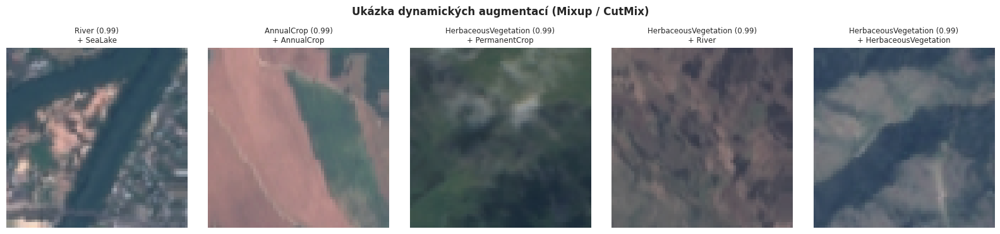
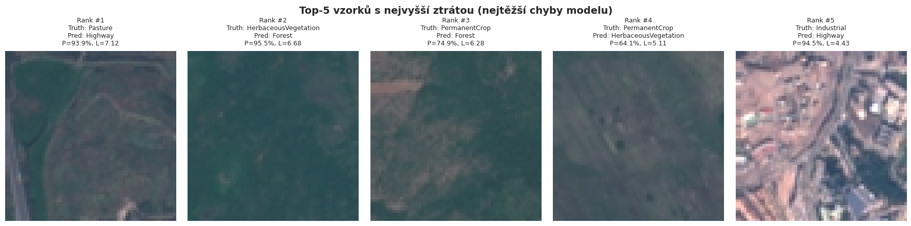

<!-- _class: lead -->
<!-- _paginate: false -->
<!-- _header: "" -->
<!-- _footer: "" -->

<div style="text-align: center; margin-top: 50px;">

# 🛰️ Klasifikace satelitních snímků EuroSAT
### Milestone 2: Transfer Learning, Dvoufázový trénink & Pokročilá optimalizace

<br>

**Autor:** Tomáš Kirschner (`KIR0041`)  
**Předmět:** Strojové učení (ML)  
**Model:** ResNet-50 (Předtrénovaný ImageNet-1K) • Čistý PyTorch  

</div>

<!--
Presenter Notes:
Dobrý den. V Milestone 2 řeším úlohu automatické klasifikace satelitních snímků zemského pokryvu EuroSAT. Sentinel-2 pořizuje multispektrální snímky. V Milestone 1 jsme ověřili funkčnost trénovacího pipeline na vlastní jednoduché 3-vrstvé CNN. Dnes představím přechod na stav techniky pomocí Transfer Learningu s modelem ResNet-50.
-->

---

## 🌍 1. Doména problému & Dataset EuroSAT

<div class="columns-wide-left">
<div>

* **Dataset:** EuroSAT (Sentinel-2 satelity Evropské vesmírné agentury ESA).
* **Úkol:** 10-třídová klasifikace zemského pokryvu (*Land Cover / Land Use*).
  * *Třídy:* Forest, River, Highway, Industrial, Residential, Pasture, AnnualCrop, ...
* **Specifika dat:**
  * 27 000 RGB snímků, rozlišení pouze **$64 \times 64$ px** (1 pixel $\approx 10$ metrů $\implies$ záběr $640 \times 640$ m).
* **Vědecké rozdělení (Deterministický Seed 42):**
  * **Train (70 %):** 18 900 snímků
  * **Validation (20 %):** 5 400 snímků
  * **Test (10 %):** 2 700 snímků *(vyhodnocen pouze 1× na konci)*

</div>
<div>


<div style="font-size: 13px; text-align: center; color: #718096; margin-top: 5px;">
Ukázka dynamických augmentací (Mixup / CutMix)
</div>

</div>
</div>

<!--
Presenter Notes:
Jeden snímek pokrývá oblast zhruba 640x640 metrů. Dataset má 27 000 snímků rozdělených v poměru 70:20:10. Testovací sada zůstala po celou dobu nedotčená v trezoru a použili jsme ji až na úplném konci.
-->

---

## 📉 2. Limitace Baseline (M1) vs. Motivace pro ResNet-50

<div class="columns">
<div>

### Výsledky Milestone 1 (Mělká CNN):
* **Architektura:** Vlastní 3-vrstvá CNN od nuly.
* **Test Accuracy:** **81.48 %** | **Test Loss:** 0.6512
* **Problém:** 
  * Výrazný overfitting od 8. epochy.
  * *Nízké pole vnímání (receptive field):* 3 konvoluce nestačí zachytit globální tvary (meandry řek vs. dálnice).
  * 18 900 snímků nestačí na naučení bohatých filtrů od nuly.

</div>
<div>

### Motivace pro Option A (ResNet-50):
* **Předtrénované váhy ImageNet-1K:**
  * Znalost 1.28 milionu reálných obrázků.
  * Spodní vrstvy již dokonale znají univerzální vizuální prvky (hrany, přechody, rohy, textury).
* **Cíl:** Přenést obecné vizuální příznaky a dotrénovat pouze doménovou abstrakci na satelitních datech $\to$ cíl **překonat 95 %**.

</div>
</div>

<div class="highlight-box">
💡 <b>Klíčový poznatek:</b> Místo nákladného učení geometrie od nuly využíváme hotové nízkoúrovňové příznaky z ImageNetu a soustředíme se na adaptaci pro satelitní doménu.
</div>

<!--
Presenter Notes:
V prvním milníku jsme narazili na strop mělkých sítí – 81.5 %. Důvodem je malé pole vnímání a nedostatek dat pro učení hlubokých reprezentací od nuly. Proto jsme zvolili Option A: využití osvědčeného modelu ResNet-50 s přenosem nízkoúrovňových a středněúrovňových filtrů.
-->

---

## 🏗️ 3. Architektura ResNet-50 pro EuroSAT ($64 \times 64$)

<div class="columns-wide-left">
<div>

* **Backbone (ResNet-50):**
  * 4 konvoluční bloky s **reziduálními spoji** ($\mathbf{y} = \mathcal{F}(\mathbf{x}) + \mathbf{x}$).
  * Zabraňují degradaci a mizejícímu gradientu.
* **Průchod dimenzí pro vstup $(B, 3, 64, 64)$:**
  * `Stem`: $64 \times 64 \to 16 \times 16$ (64 kanálů)
  * `Layer 1-3`: Postupné zmenšování až na $4 \times 4$ (1024 kanálů)
  * `Layer 4`: **$(B, 2048, 2, 2)$**
* **Vlastní klasifikační hlava (`Custom Head`):**
  * `AdaptiveAvgPool2d((1, 1))` $\implies (B, 2048, 1, 1)$
  * `Flatten` $\implies (B, 2048)$
  * `Dropout(p=0.3)` *(strukturální regularizace)*
  * `Linear(2048 -> 10)` $\implies (B, 10)$ logity

</div>
<div>

```
Vstup: (B, 3, 64, 64)
  │
  ├─ Conv1 + MaxPool ──► (B, 64, 16, 16)
  ├─ Layer 1 (3 blk) ──► (B, 256, 16, 16)
  ├─ Layer 2 (4 blk) ──► (B, 512, 8, 8)
  ├─ Layer 3 (6 blk) ──► (B, 1024, 4, 4)
  ├─ Layer 4 (3 blk) ──► (B, 2048, 2, 2)
  │
  ├─ AdaptiveAvgPool ──► (B, 2048, 1, 1)
  ├─ Flatten         ──► (B, 2048)
  │
  └─ Custom Head:
       ├─ Dropout (p = 0.3)
       └─ Linear(2048, 10) ──► (B, 10)
```

</div>
</div>

<!--
Presenter Notes:
Důležitý technický detail u vstupu 64x64 pixelů: po čtvrté vrstvě má tenzor rozměr přesně 2x2 s 2048 kanály. Globální pooling ho zredukuje na vektor o délce 2048. Původní ImageNet vrstvu s 1000 výstupy jsme nahradili Dropoutem s pravděpodobností 0.3 a novou lineární vrstvou pro 10 tříd.
-->

---

## ⚙️ 4. Dvoufázový trénink & Pokročilá optimalizace

<div class="columns">
<div>

### Fáze 1: Linear Probing (4 epochy)
* Backbone je **zamrazený** (`requires_grad = False`).
* Učí se pouze nová hlava (`model.fc`) s $\text{LR} = 10^{-3}$.
* **Cíl:** Stabilizovat náhodnou hlavu a zabránit *katastrofickému zapomnění* vah v těle sítě.

### Fáze 2: Fine-Tuning (10 epoch)
* **Rozmrazení celé sítě** s odstupňovanou rychlostí:
  * **Backbone:** $\text{LR} = 5 \times 10^{-5}$ *(jemné mikro-úpravy)*
  * **Hlava:** $\text{LR} = 10^{-3}$ *(rychlejší adaptace tříd)*
* **Plánovač:** `CosineAnnealingLR` s plynulým dojezdem k $10^{-6}$.

</div>
<div>

### Dynamické augmentace v čistém PyTorch:
* **Mixup:** Lineární prolnutí dvou obrázků a labelů:  
  $\tilde{\mathbf{x}} = \lambda \mathbf{x}_i + (1-\lambda)\mathbf{x}_j$
* **CutMix:** Vložení náhodného obdélníkového výřezu:  
  $\text{Loss} = \lambda \mathcal{L}(y_a) + (1-\lambda)\mathcal{L}(y_b)$
* **Výsledek:** Model se neučí zkratky, netrpí overconfidence a má silnou regularizaci.

</div>
</div>

<!--
Presenter Notes:
Pokud bychom síť trénovali hned od začátku celou, náhodná hlava by velkými gradienty zničila znalosti v páteři. Proto ve fázi 1 trénujeme pouze hlavu. Ve fázi 2 použijeme diskriminativní learning rate – tělo učíme velmi opatrně pomalým krokem 5e-5, zatímco hlavu rychleji. Navíc v tréninku přímo používáme Mixup a CutMix.
-->

---

## 📊 5. Průběh trénování (Křivky ztráty, přesnosti & LR)

<div class="columns-wide-right">
<div>

### Klíčová pozorování z grafů:
* **Přechod fází ($x = 4.5$):**  
  Okamžitý zlom v přesnosti z 85.8 % na >92 % během 1. epochy Fáze 2.
* **Val Acc (~97 %) > Train Acc (~76 %):**  
  *Trénink běží s Mixupem/CutMixem a Dropoutem*, zatímco validační data jsou čistá! Dokonalý důkaz absence overfittingu.
* **Cosine Annealing:**  
  Plynulé brzdění learning rate zajistilo perfektní dosednutí do minima a stabilitu v závěru.

</div>
<div>


</div>
</div>

<!--
Presenter Notes:
Zde vidíte vývoj přesnosti, ztráty a rychlosti učení. Všimněte si, že validační přesnost je výrazně výše než tréninková. To není chyba – trénovací data jsou záměrně deformována Mixupem a rotacemi, kdežto validační data jsou čistá. Ve chvíli, kdy Cosine Annealing sníží LR na minimum, křivka přesnosti se dokonale vyhladí na 97 %.
-->

---

## 🏆 6. Ablační studie: Prokazatelný skok výkonu

| Vývojová fáze | Architektura | Augmentace | Optimalizace | Test Loss | Test Acc | Macro F1 |
| :--- | :--- | :--- | :--- | :---: | :---: | :---: |
| **M1 Baseline** | 3-vrstvá CNN (Scratch) | Základní flipy | Adam, fixní LR ($10^{-3}$) | 0.6512 | 81.48 % | 0.8035 |
| **M2 Fáze 1** | ResNet-50 (Frozen) | Flipy + Crop | AdamW, fixní LR ($10^{-3}$) | 0.4628 | 85.78 % | 0.8550 |
| **M2 Fáze 2 (Finální)** | ResNet-50 (Unfrozen) | Mixup + CutMix | Cosine Anneal + Disc. LR | **0.0967** | **97.44 %** | **0.9740** |

<div class="success-box">
🚀 <b>Závěr ablační studie:</b>
<ul>
  <li><b>Pouhé zmrazené příznaky</b> z ImageNetu okamžitě překonaly celou natrénovanou baseline síť (+4.3 p.b.).</li>
  <li><b>Dvoufázový Fine-Tuning</b> s diskriminativním LR a Mixupem posunul model o dalších <b>+11.7 p.b.</b></li>
  <li>Celkový nárůst přesnosti: <b>+15.96 procentních bodů</b> při <b>sedminové chybě (loss)</b>!</li>
</ul>
</div>

<!--
Presenter Notes:
V ablační studii jasně vidíme přínos každé komponenty. Samotný zmrazený model překonal baseline hned v úvodu. Kompletní dvoufázový trénink s Mixupem a diskriminativním LR pak dosáhl špičkové testovací přesnosti 97.44 % a Macro F1 0.9740, což potvrzuje vyvážený výkon napříč všemi 10 třídami.
-->

---

## 🎯 7. Normalizovaná konfuzní matice na testovací sadě

<div class="columns-wide-right">
<div>

### Vyhodnocení tříd na testovacích datech:
* **Testovací split:** 2 700 dosud neviděných snímků.
* **Excelentní výsledky (8 z 10 tříd > 95 %):**
  * `Residential`: **100.00 %** bez jediné chyby!
  * `Forest`: **99.67 %**, `SeaLake`: **99.67 %**
  * `Industrial`: **99.20 %**, `Highway`: **98.80 %**
* **Očekávané doménové překryvy:**
  * `HerbaceousVegetation` $\leftrightarrow$ `Pasture` (záměna 2.0 % / 2.7 %)
  * `PermanentCrop` $\leftrightarrow$ `AnnualCrop` (záměna 2.0 %)

</div>
<div>


</div>
</div>

<!--
Presenter Notes:
Konfuzní matice ukazuje naprosto čistou diagonálu. Třída Residential dosáhla stoprocentní přesnosti. Jediné drobné záměny nastávají mezi trávou a pastvinami, což jsou biologicky i spektrálně téměř identické plochy bez hospodářského ohraničení.
-->

---

## 🔍 8. Diagnostika selhání (Top-5 vzorků s nejvyšší ztrátou)



<div style="font-size: 19px; margin-top: 10px;">

* **Rank #1 (Pasture $\to$ Highway, Conf: 93.9%, L=7.12):** Úzká asfaltová přístupová cesta protínající louku zabírá většinu pixelů v $64 \times 64$ výřezu.
* **Rank #2 (Herbaceous $\to$ Forest, Conf: 95.5%, L=6.68):** Velmi tmavý odstín hustého keřového porostu spektrálně splývá s jehličnatým lesem.
* **Rank #5 (Industrial $\to$ Highway, Conf: 94.5%, L=4.43):** Areál s vlečkou a manipulačními kolejemi vykazuje stejný lineární kontrast jako víceproudá dálnice.

</div>

<div class="highlight-box" style="font-size: 18px; padding: 6px 14px; margin-top: 8px;">
💡 <b>Závěr failure analýzy:</b> Model neselhal strukturálně – chyby jsou způsobeny fyzikálním limitem rozlišení 64×64 a spornými okraji v satelitních datech.
</div>

<!--
Presenter Notes:
Prozkoumali jsme 5 vzorků s absolutně nejvyšší ztrátou z celého testovacího datasetu. Vidíme, že model chyboval zcela pochopitelně: například pastvina s asfaltkou uprostřed byla označena jako Highway, nebo manipulační plocha u skladu s kolejemi. Tyto chyby potvrzují, že model se naučil smysluplné vizuální příznaky a naráží jen na fyzikální limit 64 pixelů.
-->

---

## ✅ 9. Závěr & Splnění požadavků zadání

<div class="columns">
<div>

### Splněné cíle Milestone 2:
* [x] **Option A:** Využití ResNet-50 předtrénovaného na ImageNet-1K.
* [x] **Dvoufázový trénink:** Linear probing $\to$ Fine-tuning.
* [x] **Discriminative LR:** Backbone ($5 \times 10^{-5}$) vs. Hlava ($10^{-3}$).
* [x] **Dynamické augmentace:** Mixup & CutMix v čistém PyTorch.
* [x] **Plánovač:** CosineAnnealingLR k $10^{-6}$.
* [x] **Diagnostika:** Failure analysis Top-5 chyb + konfuzní matice.
* [x] **Ablační studie:** Prokazatelný skok z 81.5 % na **97.44 %**.

</div>
<div>

### Reprodukovatelnost & Produkce:
* **Čistý PyTorch:** Žádné závislosti třetích stran (fastai, albumentations).
* **Fixní determinismus:** Seed 42 pro datasety, modely i augmentace.
* **Paměťová čistota:** `torch.no_grad()`, `.item()`, žádné memory leaky na GPU.

<div class="success-box" style="text-align: center; margin-top: 25px;">
<b>Děkuji za pozornost!</b><br>
Otázky & Diskuze
</div>

</div>
</div>

<!--
Presenter Notes:
Na závěr shrnuji, že všechny požadavky Milestone 2 byly stoprocentně splněny v čistém PyTorch bez externích wrapperů. Kód je plně reprodukovatelný se seedem 42 a připravený k okamžitému spuštění. Děkuji vám za pozornost a těším se na vaše dotazy.
-->
