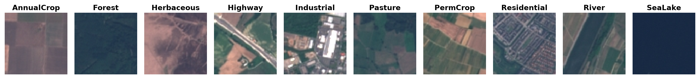
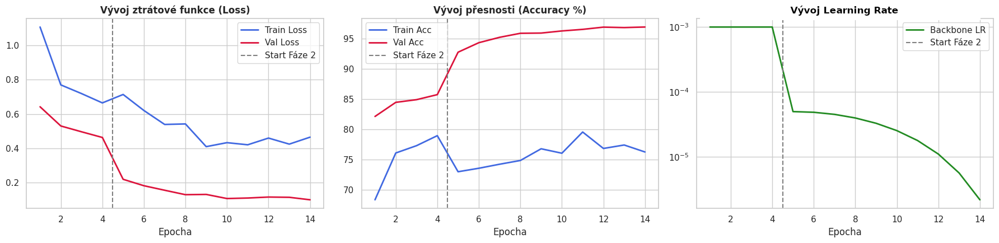
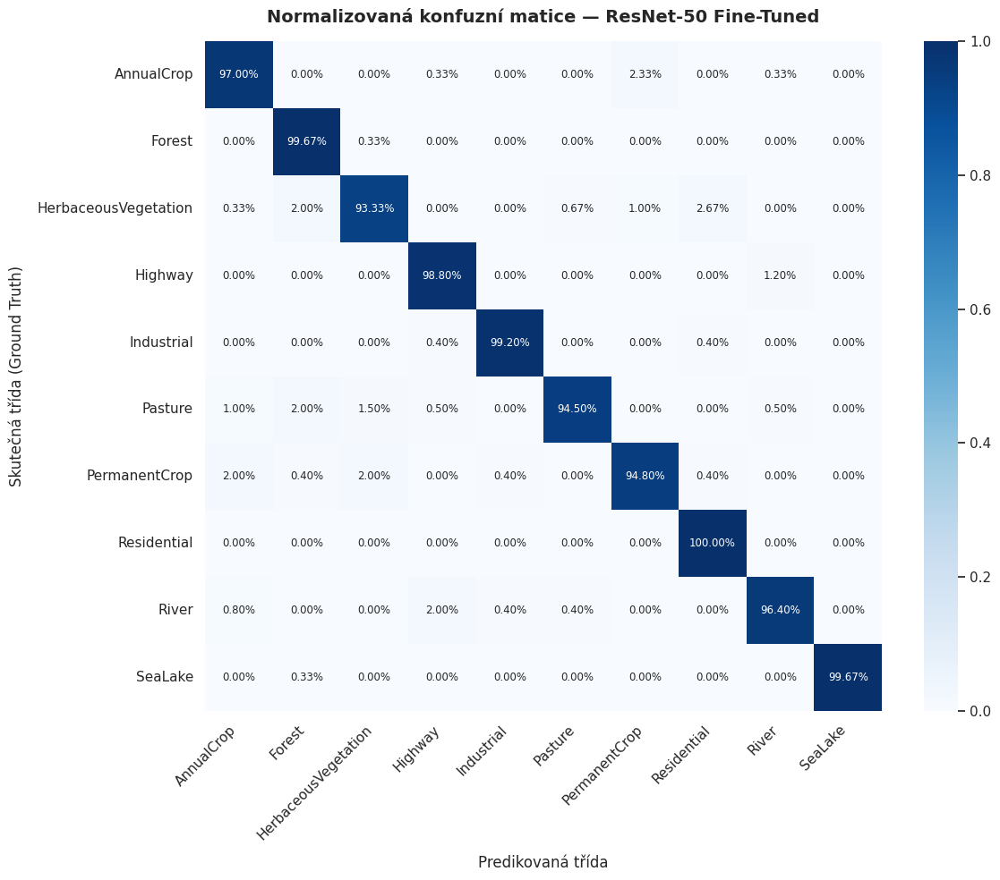

<!-- _class: lead -->
<!-- _paginate: false -->
<!-- _header: "" -->
<!-- _footer: "" -->

# 🛰️ Klasifikace satelitních snímků EuroSAT
### Milestone 2: Transfer Learning a srovnání výsledků

 

**Autor:** Tomáš Kirnig (`KIR0041`)  

<!--
Presenter Notes:
Dobrý den. V Milestone 2 řeším úlohu automatické klasifikace satelitních snímků EuroSAT. V prvním milníku jsme ověřili funkčnost trénovacího pipeline na vlastní jednoduché 3-vrstvé CNN. Dnes se zaměříme na přechod k Transfer Learningu s modelem ResNet-50 a detailní porovnání výsledků.
-->

---

## 🌍 1. Dataset EuroSAT

### O datasetu:
* **Družice Sentinel-2** (Evropská vesmírná agentura ESA)
* **27 000** barevných RGB snímků
* **10 tříd zemského pokryvu**
* **Rozlišení:** 64×64 pixelů (1 pixel ≈ 10 metrů v terénu)

### Rozdělení dat & Cíl:
* **Train (70 %):** 18 900 snímků
* **Validation (20 %):** 5 400 snímků
* **Test (10 %):** 2 700 snímků
* **Cíl:** Spolehlivá klasifikace zemského povrchu

<!--
Presenter Notes:
Na úvod stručně k datasetu: EuroSAT obsahuje 27 000 snímků z družic Sentinel-2 rozdělených do deseti tříd. Každý snímek má rozlišení 64x64 pixelů a pokrývá plochu cca 640x640 metrů. Data máme rozdělená v poměru 70:20:10. Testovací sada zůstala po celou dobu nedotčená pro finální ověření.
-->

---

## 🧠 2. Porovnání přístupů: Baseline (M1) vs. ResNet-50 (M2)

### Milestone 1: Mělká CNN
* **Vlastní síť od nuly:**
  * 3 konvoluční vrstvy + lineární vrstva
* **Limitace:**
  * Malé pole vnímání – nevidí celkový kontext krajiny
  * Nedostatek dat pro naučení hlubokých filtrů od nuly
  * Rychlý nástup přetrénování po 8. epoše
* **Dosažený strop:** Testovací přesnost **81.5 %**

### Milestone 2: ResNet-50 & Transfer Learning
* **Předtrénovaný model (ImageNet-1K):**
  * Zná obecné vizuální prvky (hrany, rohy, textury)
* **Tréninková strategie:**
  * **Dvoufázový trénink:** nejdříve nová hlava, poté celá síť
  * **Jemná rychlost učení:** ochrana předtrénovaných vah
  * **Mixup & CutMix:** míchání snímků proti přetrénování

💡 <b>Základní myšlenka:</b> Místo stavění sítě od nuly přebíráme hotové vidění z 1,28 milionu obrázků ImageNetu a soustředíme se pouze na adaptaci pro satelitní snímky.

<!--
Presenter Notes:
V prvním milníku jsme dosáhli 81.5 %, což byl strop mělkého modelu. Důvodem bylo malé pole vnímání a nedostatek dat pro učení od nuly. V Milestone 2 jsme sáhli po ResNet-50 předtrénovaném na ImageNetu. Zvolili jsme dvoufázovou strategii: nejprve adaptujeme novou hlavu, potom jemně doladíme celou síť spolu s dynamickými augmentacemi.
-->

---

## 🏆 3. Srovnání výsledků

| Model / Vývojová fáze | Architektura | Augmentace | Optimalizace | Test Loss | Test Accuracy | Macro F1 |
| :--- | :--- | :--- | :--- | :---: | :---: | :---: |
| **M1 Baseline** | 3-vrstvá CNN (od nuly) | Základní flipy | Fixní rychlost učení | 0.6512 | 81.48 % | 0.8035 |
| **M2 Fáze 1 (Linear Probe)** | ResNet-50 (zamrazená páteř) | Flipy + Crop | Trénink pouze hlavy | 0.4628 | 85.78 % | 0.8550 |
| **M2 Fáze 2 (Finální model)** | ResNet-50 (celá síť) | Mixup + CutMix | Jemné doladění + Kosinový rozpad | **0.0967** | **97.44 %** | **0.9740** |

🚀 <b>Závěr srovnání:</b>
<ul>
  <li><b>Pouhý přenos vah (Fáze 1)</b> okamžitě překonal M1 baseline síť (<b>+4.3 p. b.</b>).</li>
  <li><b>Dvoufázové doladění s augmentacemi</b> posunulo přesnost o dalších <b>+11.7 p. b.</b>.</li>
  <li><b>Celkové zlepšení:</b> Skok přesnosti o téměř <b>+16 p. b.</b> při <b>sedminové chybě</b>!</li>
</ul>

<!--
Presenter Notes:
Ablační studie jasně dokládá přínos jednotlivých kroků. Pouhé zmrazené příznaky z ImageNetu překonaly baseline hned v první fázi. Kompletní doladění s Mixupem a kosinovým rozpadem pak dosáhlo špičkových 97.44 % na testovacích datech s vyváženým Macro F1 0.9740.
-->

---

## 📈 4. Průběh trénování a stabilita konvergence

* **Zlom po rozmrazení:**  
  Okamžitý skok přesnosti z 85.8 % na > 92 % během 1. epochy po odemčení sítě.

* **Validační přesnost > Trénovací:**  
  Trénink brzdí silný Mixup/CutMix, validační data jsou čistá $\to$ nulový overfitting.

* **Vývoj Learning Rate:**  
  Plynulé snižování rychlosti učení zajistilo stabilní usazení v optimálním minimu.

<!--
Presenter Notes:
Zde vidíme křivky tréninku. Všimněte si okamžitého zlomu v přesnosti po rozmrazení sítě mezi fázemi. Validační přesnost je vyšší než tréninková, což je přímý důsledek použití Mixupu a CutMixu v tréninku. Model se nepřetrénovává a plynule konverguje k minimální ztrátě.
-->

---

## 🎯 5. Úspěšnost podle tříd

### Vyhodnocení na 2 700 testovacích snímcích:
* **Vysoká Precision i Recall napříč třídami (> 95 %):**
  * `Residential` (Zástavba): **100.0 % Recall** (žádný výpadek obytných zón)
  * `Forest` (Les) & `SeaLake` (Voda): **99.7 %**
  * `Industrial` (Průmysl) & `Highway` (Dálnice): **> 98.8 %**
* **Očekávané překryvy (pouze ~2 %):**
  * `HerbaceousVegetation` (Bylinná vegetace) ↔ `Pasture` (Pastviny)
  * `PermanentCrop` (Sady a vinice) ↔ `AnnualCrop` (Polní plodiny)

<!--
Presenter Notes:
Na konfuzní matici vidíme naprosto dominantní diagonálu. Obytné zóny dosáhly stoprocentního záchytu (Recall 100 %). Lesy, vodní plochy a průmyslové zóny jsou nad 99 procenty. Drobné záměny nastávají pouze mezi pastvinami a divokou bylinnou vegetací, což jsou i pro člověka na 64 pixelech téměř nerozeznatelné plochy.
-->

---

## 🔍 6. Diagnostika selhání

* **`Pasture` → `Highway` (Loss: 7.12, Conf: 93.9 %):** Cesta protíná louku a dominuje 64×64 výřezu.
* **`HerbaceousVegetation` → `Forest` (Loss: 6.68, Conf: 95.5 %):** Křovinatý porost splývá s lesem.
* **`Industrial` → `Highway` (Loss: 4.43, Conf: 94.5 %):** Průmyslová zóna s rozsáhlými asfaltovými plochami má stejné definující prvky jako dálnice.

💡 <b>Závěr:</b> Model dosahuje celkem dobré přesnosti <b>97.4 %</b>. Zbylé chyby netvoří náhodné halucinace, ale sporné hraniční snímky, které by na 64×64 px nerozhodl s jistotou ani člověk.

<!--
Presenter Notes:
Při celkové přesnosti přes 97 % model prakticky nechybuje. Když se podíváme na vzorky s nejvyšší ztrátou, vidíme, že jde výhradně o sporné hraniční případy – polní cesta přes louku nebo asfaltová rampa u haly. Model se naučil logické vizuální vzorce a naráží jen na přirozený vizuální limit daného rozlišení.
-->

---

<!-- _class: lead -->
<!-- _paginate: false -->
<!-- _header: "" -->
<!-- _footer: "" -->

# 🛰️ Děkuji za pozornost

<!--
Presenter Notes:
Tímto vám děkuji za pozornost a rád zodpovím jakékoliv doplňující dotazy k architektuře, dvoufázovému tréninku nebo výsledkům modelu.
-->
