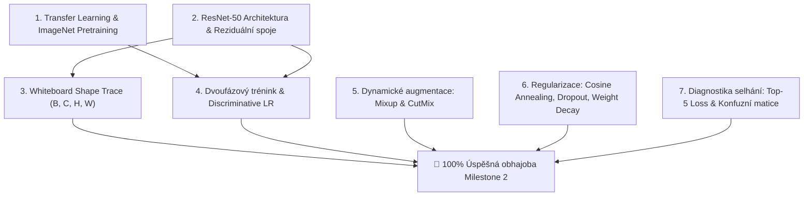

# 🎓 Interaktivní Tabule — Příprava na Obhajobu Milestone 2

Tento dokument slouží jako **příprava k tabuli (Whiteboard Defense)** pro Milestone 2: Transfer Learning, pokročilé optimalizace, augmentace a diagnostika selhání.

---

## 🗺️ Přehled konceptů (Dependency Graph)

---

## 📐 Uzel 1: Whiteboard Shape Trace pro ResNet-50 na EuroSAT (64×64)

Vstupní tenzor: $\mathbf{X} \in \mathbb{R}^{B \times 3 \times 64 \times 64}$

| Vrstva / Blok | Operace | Výpočet rozměru | Výstupní tvar tenzoru |
| :--- | :--- | :--- | :--- |
| **Vstup** | EuroSAT RGB | $64 \times 64$ | `(B, 3, 64, 64)` |
| **Stem: Conv1** | Conv2d($3 \to 64$, k=7, s=2, p=3) | $\lfloor\frac{64 + 2\cdot 3 - 7}{2}\rfloor + 1 = 32$ | `(B, 64, 32, 32)` |
| **Stem: MaxPool** | MaxPool2d(k=3, s=2, p=1) | $\lfloor\frac{32 + 2\cdot 1 - 3}{2}\rfloor + 1 = 16$ | `(B, 64, 16, 16)` |
| **Layer 1** | 3× Bottleneck block (s=1) | Stride 1, kanály $64 \to 256$ | `(B, 256, 16, 16)` |
| **Layer 2** | 4× Bottleneck block (s=2) | Stride 2 v 1. bloku, kanály $256 \to 512$ | `(B, 512, 8, 8)` |
| **Layer 3** | 6× Bottleneck block (s=2) | Stride 2 v 1. bloku, kanály $512 \to 1024$ | `(B, 1024, 4, 4)` |
| **Layer 4** | 3× Bottleneck block (s=2) | Stride 2 v 1. bloku, kanály $1024 \to 2048$ | `(B, 2048, 2, 2)` |
| **Global Pool** | AdaptiveAvgPool2d((1, 1)) | Průměrování přes prostorové dimenze | `(B, 2048, 1, 1)` |
| **Flatten** | `torch.flatten(x, 1)` | Zploštění prostorových dimenzí | `(B, 2048)` |
| **Dropout** | `nn.Dropout(p=0.3)` | Náhodné nulování neuronů s faktorem $\frac{1}{1-p}$ | `(B, 2048)` |
| **Vlastní hlava** | `nn.Linear(2048, 10)` | Maticové násobení $\mathbf{X}\mathbf{W}^T + \mathbf{b}$ | `(B, 10)` (Logity) |

> ⚠️ **POZOR U TABULE:** Na rozdíl od standardního ImageNet vstupu ($224 \times 224$), kde má Layer 4 výstup $(B, 2048, 7, 7)$, u EuroSAT ($64 \times 64$) má Layer 4 výstup **přesně $(B, 2048, 2, 2)$**!

---

## ⚡ Uzel 2: Proč funguje Reziduální spoj (Residual Connection)?

Základní stavební blok ResNetu:
$$\mathbf{y} = \mathcal{F}(\mathbf{x}, \{W_i\}) + \mathbf{x}$$

Při zpětném průchodu (backpropagation) podle řetízkového pravidla:
$$\frac{\partial \mathcal{E}}{\partial \mathbf{x}} = \frac{\partial \mathcal{E}}{\partial \mathbf{y}} \cdot \frac{\partial \mathbf{y}}{\partial \mathbf{x}} = \frac{\partial \mathcal{E}}{\partial \mathbf{y}} \left( \frac{\partial \mathcal{F}}{\partial \mathbf{x}} + \mathbf{I} \right) = \frac{\partial \mathcal{E}}{\partial \mathbf{y}} \frac{\partial \mathcal{F}}{\partial \mathbf{x}} + \frac{\partial \mathcal{E}}{\partial \mathbf{y}}$$

### Klíčový argument pro zkoušejícího:
Díky aditivnímu členu $+\mathbf{I}$ gradient $\frac{\partial \mathcal{E}}{\partial \mathbf{y}}$ **protéká přímo (identity shortcut)** do předchozích vrstev i v případě, kdy by gradient v nelineární větvi $\frac{\partial \mathcal{F}}{\partial \mathbf{x}}$ konvergoval k nule. Tím je matematicky eliminován problém mizejícího gradientu (vanishing gradient) i u sítí s více než 50 vrstvami.

---

## 🔬 Uzel 3: Dvoufázová trénovací strategie a Diskriminativní Learning Rate

1. **Fáze 1: Linear Probing (Zmrazený backbone)**
   - Všechny vrstvy `model.parameters()` mají `requires_grad = False`.
   - Pouze `model.fc` má `requires_grad = True`.
   - **Proč:** Hlava je náhodně inicializovaná ($2048 \times 10$). Kdybychom okamžitě pustili velký gradient do celé sítě, náhodné gradienty z hlavy by zničily předtrénované příznaky v backbone (**Catastrophic Forgetting**).
   - Trénink: 3–5 epoch, $\text{LR} = 10^{-3}$, AdamW.

2. **Fáze 2: Gradual Unfreezing s Diskriminativním LR**
   - Rozmrazíme `layer4` a celou hlavu `fc` (případně i spodní vrstvy).
   - Skupiny parametrů (Parameter Groups):
     - `layer4`: $\text{LR} = 10^{-4}$ (nebo $5 \cdot 10^{-5}$) — jemné doladění doménově specifických vyšších příznaků.
     - `fc`: $\text{LR} = 10^{-3}$ — rychlejší adaptace klasifikátoru.
   - **Plánovač:** `CosineAnnealingLR` snižuje LR plynule podle kosinové křivky k nule ($10^{-6}$).

---

## 🎲 Uzel 4: Pokročilé dynamické augmentace (Mixup & CutMix)

### 1. Mixup
Konvexní kombinace dvou náhodných obrázků a jejich one-hot štítků:
$$\lambda \sim \text{Beta}(\alpha, \alpha), \quad \alpha = 0.2$$
$$\tilde{\mathbf{x}} = \lambda \mathbf{x}_i + (1 - \lambda) \mathbf{x}_j$$
$$\mathcal{L} = \lambda \mathcal{L}_{\text{CE}}(\hat{\mathbf{y}}, \mathbf{y}_i) + (1 - \lambda) \mathcal{L}_{\text{CE}}(\hat{\mathbf{y}}, \mathbf{y}_j)$$

### 2. CutMix
Výřez obdélníkové oblasti z jednoho obrázku a vložení do druhého:
Prostorový poměr výřezu přesně odpovídá váze ztráty $\lambda = 1 - \frac{W_{\text{box}} H_{\text{box}}}{W H}$.

### Proč Mixup/CutMix?
- Zabraňují overconfidence neuronové sítě (fungují jako adaptivní label smoothing).
- Nutí síť zaměřit se na globální i dílčí textury, ne na jeden dominantní pixelový vzor.

---

## 📊 Uzel 5: Diagnostika selhání (Failure Analysis)

- Spočítáme ztrátu per-sample: $\ell_i = -\log p(y_i \mid \mathbf{x}_i)$.
- Seřadíme vzorky a vybereme **Top-5 vzorků s nejvyšší ztrátou (Highest Loss)**.
- Typické záměny v EuroSAT:
  - *Herbaceous Vegetation* vs. *Pasture* (spektrálně a strukturně identická travnatá plocha).
  - *Industrial Buildings* vs. *Highway* / *Residential* (betonové a asfaltové povrchy se stejnou odrazivostí).
