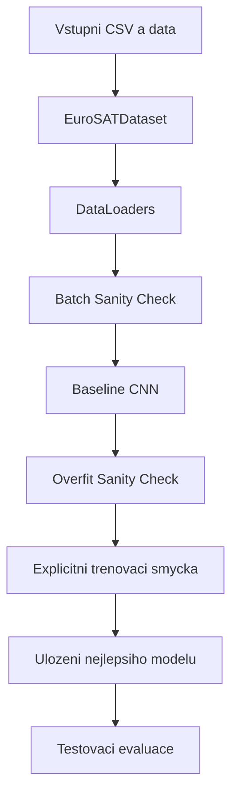

# 🗺️ Projektová Roadmapa: Klasifikace EuroSAT (RGB)

Tato roadmapa představuje detailní plán kroků a milníků nezbytných pro splnění zadání projektu (`Zadani.txt`) v souladu s principy stanovenými v [`PRINCIPLES.md`](file:///C:/Users/tomki/Desktop/Ing_wannabe/ML_project/PRINCIPLES.md) a tahákem [`tahak.md`](file:///C:/Users/tomki/Desktop/Ing_wannabe/ML_project/tahak.md).

---

## 📌 Aktuální stav projektu v [`ML_project_1.ipynb`](file:///C:/Users/tomki/Desktop/Ing_wannabe/ML_project/ML_project_1.ipynb)

* [x] **Krok 0: Příprava prostředí a EDA** — Automatická detekce CUDA GPU, rozbalení dat, 27 000 snímků, vyváženost tříd a barevné profily.
* [x] **Krok 1.1: Zakázkový datový pipeline** — Třída `EuroSATDataset(Dataset)` s lazy loadingem z disku, on-the-fly augmentacemi a bezpečnými DataLoadery. *(Ověřeno)*
* [x] **Krok 1.2: Vizuální inspekce dávky (Batch Sanity Check)** — Ověřeny rozměry tenzorů `(64, 3, 64, 64)`, štítků `(64)` a vizuální galerie 8 vzorků. *(Ověřeno)*
* [x] **Krok 1.3: Baseline CNN model & Whiteboard Defense** — 3bloková konvoluční síť `BaselineCNN` (2,19M parametrů), tabulka rozměrů a testovací forward pass na GPU. *(Ověřeno)*
* [x] **Krok 1.4: The Overfit Sanity Check** — Kód připraven v buňkách 23 a 24 (přetrénování 16 vzorků na 100 % přesnost a nulovou ztrátu). *(Připraveno ke spuštění)*
* [x] **Krok 1.5: Explicitní trénovací a validační smyčka** — Kód připraven v buňkách 25–28 (ruční smyčka v čistém PyTorch, checkpointing `best_baseline.pt`, grafy učení). *(Připraveno ke spuštění)*
* [x] **Krok 1.6: Evaluace a analýza chyb** — Kód připraven v buňkách 29–33 (testovací sada, Confusion Matrix, per-class report a vizuální galerie chyb). *(Připraveno ke spuštění)*
* [x] **Krok 1.7: Kontrolní checklist pro konzultaci Milestone 1** — Kód připraven v buňce 34.

---

## 🚀 Fáze 1: Milestone 1 — Data Pipeline & Baseline Model

Cíl: Vytvořit plně funkční, čistý a bezchybný end-to-end trénovací pipeline v čistém PyTorch bez jakýchkoliv externích wrapperů.

### 📊 Schéma postupu Milestone 1

```text
┌───────────────────────────────────────┐
│ Vstupní CSV soubory a složky obrázků  │
└──────────────────┬────────────────────┘
                   │
                   ▼
┌───────────────────────────────────────┐
│ EuroSATDataset (dědění z Dataset)     │  [x] HOTOVO & OVĚŘENO
│ (Lazy loading + on-the-fly augmentace)│
└──────────────────┬────────────────────┘
                   │
                   ▼
┌───────────────────────────────────────┐
│ DataLoaders (Train, Val, Test)        │  [x] HOTOVO & OVĚŘENO
│ (Batch 64, shuffle=True, pin_memory)  │
└──────────────────┬────────────────────┘
                   │
                   ▼
┌───────────────────────────────────────┐
│ Batch Sanity Check & Galerie          │  [x] HOTOVO & OVĚŘENO
│ (Ověření tvaru (64, 3, 64, 64))       │
└──────────────────┬────────────────────┘
                   │
                   ▼
┌───────────────────────────────────────┐
│ BaselineCNN (3 konvoluční bloky)      │  [x] HOTOVO & OVĚŘENO
│ (Bez předtrénovaných vah, logits out) │
└──────────────────┬────────────────────┘
                   │
                   ▼
┌───────────────────────────────────────┐
│ The Overfit Sanity Check              │  [x] IMPLEMENTOVÁNO
│ (16 vzorků -> 100% acc, loss ~ 0)     │
└──────────────────┬────────────────────┘
                   │
                   ▼
┌───────────────────────────────────────┐
│ Explicitní trénovací & validační loop │  [x] IMPLEMENTOVÁNO
│ (zero_grad -> forward -> back -> step)│
└──────────────────┬────────────────────┘
                   │
                   ▼
┌───────────────────────────────────────┐
│ Uložení nejlepších vah do checkpointu │  [x] IMPLEMENTOVÁNO
│ (best_baseline.pt podle val_loss)     │
└──────────────────┬────────────────────┘
                   │
                   ▼
┌───────────────────────────────────────┐
│ Testovací evaluace & Matice záměn     │  [x] IMPLEMENTOVÁNO
│ (Confusion Matrix a analýza chyb)     │
└───────────────────────────────────────┘
```



---

### Krok 1.1: Refaktoring datového pipeline na zakázkový `Dataset` ✅
*Splňuje požadavek zadání: "subclass torch.utils.data.Dataset implementing custom `__len__` and `__getitem__`"*

- **Status:** **DOKONČENO A OVĚŘENO** v buňce 15 a 16.
- **Implementace:** Třída `EuroSATDataset` s lazy loadingem a oddělenými transformacemi:
  - `train_transform`: `RandomHorizontalFlip` + `RandomVerticalFlip` + `ToTensor` + z-score `Normalize`.
  - `eval_transform`: `ToTensor` + z-score `Normalize`.
- **DataLoadery:**
  - Train: 296 dávek (18 900 vzorků), `shuffle=True`, `pin_memory=True`.
  - Val: 85 dávek (5 400 vzorků), `shuffle=False`.
  - Test: 43 dávek (2 700 vzorků), `shuffle=False`.

---

### Krok 1.2: Vizuální inspekce dávky (Batch Inspection) ✅
*Splňuje požadavek zadání: "visualize at least one batch post-transformation with correct tensor shapes"*

- **Status:** **DOKONČENO A OVĚŘENO** v buňce 18.
- **Výsledky ověření:**
  - Tvar obrazového tenzoru: `torch.Size([64, 3, 64, 64])` (typ `torch.float32`).
  - Tvar labelů: `torch.Size([64])` (typ `torch.int64`).
  - Rozsah hodnot po z-score standardizaci: min=-1.729, max=5.120.
  - Vykreslena vizuální galerie 8 snímků po inverzní denormalizaci potvrzující správné párování tříd.

---

### Krok 1.3: Návrh a analýza Baseline CNN ("Whiteboard Defense") ✅
*Splňuje požadavek zadání: "straightforward baseline network from scratch (e.g. a simple 2–3 layer CNN); whiteboard/shape defense"*

- **Status:** **DOKONČENO A OVĚŘENO** v buňkách 20, 21 a 22.
- **Architektura:**
  - Blok 1: `Conv2d(3, 32, k=3, p=1)` $\to$ `BatchNorm2d(32)` $\to$ `ReLU()` $\to$ `MaxPool2d(2, 2)`
  - Blok 2: `Conv2d(32, 64, k=3, p=1)` $\to$ `BatchNorm2d(64)` $\to$ `ReLU()` $\to$ `MaxPool2d(2, 2)`
  - Blok 3: `Conv2d(64, 128, k=3, p=1)` $\to$ `BatchNorm2d(128)` $\to$ `ReLU()` $\to$ `MaxPool2d(2, 2)`
  - Hlava: `Flatten()` $\to$ `Linear(8192, 256)` $\to$ `ReLU()` $\to$ `Dropout(0.3)` $\to$ `Linear(256, 10)`
- **Parametry:** Celkem 2 193 674 parametrů (všechny trénovatelné).
- **Forward Pass:** Vstup `(64, 3, 64, 64)` na `cuda:0` $\to$ výstup `(64, 10)` surových logits.

---

### Krok 1.4: "The Overfit Sanity Check" ✅ *(Připraveno ke spuštění)*
*Splňuje požadavek zadání: "take a tiny slice of data (8–16 samples) and show your model can overfit it to near-zero loss and 100% accuracy"*

- **Status:** Implementováno v buňkách 23 a 24.
- **Implementace:**
  1. Extrakce 16 vzorků (`tiny_imgs`, `tiny_lbls`).
  2. Inicializace čistého modelu `overfit_model` a explicitní trénovací smyčka na 40 epoch.
  3. Automatické vykreslení křivek konvergence Loss a Accuracy.
- **Kritérium úspěchu:** `loss < 0.05` a `accuracy = 100 %`.

---

### Krok 1.5: Explicitní trénovací a validační smyčka ✅ *(Připraveno ke spuštění)*
*Splňuje požadavek zadání: "Explicit training loop: write complete training and validation loops manually"*

- **Status:** Implementováno v buňkách 25, 26, 27 a 28.
- **Implementace:**
  - Funkce `train_model()` v čistém PyTorch na 12 epoch.
  - Strict oddělení `model.train()` a `model.eval()`.
  - Validační fáze pod `with torch.no_grad():`.
  - 5 kanonických kroků trénování: `optimizer.zero_grad()`, `forward`, `loss`, `backward()`, `optimizer.step()`.
  - Přesná agregace `running_loss += loss.item() * xb.size(0)`.
  - Ukládání checkpointu `best_baseline.pt` při nejlepším `val_loss`.
  - Automatické načtení nejlepších vah na konci a vykreslení křivek učení.

---

### Krok 1.6: Vyhodnocení Baseline na testovací sadě & Analýza chyb ✅ *(Připraveno ke spuštění)*
- **Status:** Implementováno v buňkách 29, 30, 31, 32 a 33.
- **Výstupy:**
  - Testovací Accuracy a Testovací Loss na neviděných 2 700 snímcích.
  - Podrobný per-class `classification_report` (Precision, Recall, F1-Score).
  - Vykreslení **normalizované konfuzní matice (Confusion Matrix)** v procentech.
  - Galerie 8 chybně klasifikovaných snímků s vypsanou pravděpodobností a rozborem záměn.

---

### Krok 1.7: Kontrolní checklist pro konzultaci Milestone 1 ✅
- **Status:** Shrnutí a checklist v buňce 34 připraven pro kontrolu před konzultací.
