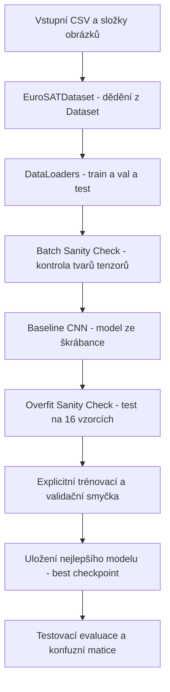

# 🗺️ Projektová Roadmapa: Klasifikace EuroSAT (RGB)

Tato roadmapa představuje detailní plán kroků a milníků nezbytných pro splnění zadání projektu (`Zadani.txt`) v souladu s principy stanovenými v [`PRINCIPLES.md`](file:///C:/Users/tomki/Desktop/Ing_wannabe/ML_project/PRINCIPLES.md).

---

## 📌 Přehled stavu projektu

- **Aktuální stav (`ML_project_1.ipynb`)**:
  - [x] Prostředí a importy knihoven.
  - [x] Průzkumná analýza dat (EDA: vyváženost tříd, ukázky snímků, histogramy RGB, barevné profily).
  - [⚠️] Datový pipeline: Momentálně načítá všech 27 000 obrázků najednou do paměti a využívá provizorní `TensorDataset`.
  - [ ] **Chybí splnění klíčových bodů Milestone 1 dle `Zadani.txt`**:
    - Vlastní třída `EuroSATDataset(Dataset)` s lazy loadingem a on-the-fly transformacemi.
    - Vizualizace dávky po transformaci s kontrolou tvarů `(B, C, H, W)`.
    - Vlastní baseline CNN model ze škrábance (`nn.Module`) bez předtrénovaných vah.
    - Analytický rozpad dimenzí tenzorů pro "Whiteboard defense".
    - "Overfit Sanity Check" na 8–16 vzorcích (důkaz konvergence ke 100 % acc).
    - Plná explicitní trénovací a validační smyčka v čistém PyTorch s checkpointingem.
    - Evaluace baseline modelu (Confusion Matrix, per-class metriky).

---

## 🚀 Fáze 1: Milestone 1 — Data Pipeline & Baseline Model

Cíl: Vytvořit plně funkční, čistý a bezchybný end-to-end trénovací pipeline v čistém PyTorch bez jakýchkoliv externích wrapperů.



---

### Krok 1.1: Refaktoring datového pipeline na zakázkový `Dataset`
*Splňuje požadavek zadání: "subclass torch.utils.data.Dataset implementing custom `__len__` and `__getitem__`"*

- **Úkol**: Nahradit paměťově náročný `load_split()` a `TensorDataset` čistou třídou `EuroSATDataset`.
- **Specifikace třídy**:
  ```python
  class EuroSATDataset(torch.utils.data.Dataset):
      def __init__(self, df, data_dir, transform=None):
          self.df = df.reset_index(drop=True)
          self.data_dir = Path(data_dir)
          self.transform = transform

      def __len__(self):
          return len(self.df)

      def __getitem__(self, idx):
          row = self.df.iloc[idx]
          img_path = self.data_dir / row["Filename"]
          image = Image.open(img_path).convert("RGB")
          label = int(row["Label"])
          if self.transform:
              image = self.transform(image)
          return image, torch.tensor(label, dtype=torch.long)
  ```
- **Definice transformací**:
  - `train_transform`: `transforms.RandomHorizontalFlip()`, `transforms.RandomVerticalFlip()`, `transforms.ToTensor()`, `transforms.Normalize(mean, std)`. *(Satelitní snímky mají rotační a zrcadlovou invarianci!)*
  - `eval_transform`: `transforms.ToTensor()`, `transforms.Normalize(mean, std)`.
- **DataLoaders**:
  - Trénovací: `batch_size=64`, `shuffle=True`, `num_workers=2`, `pin_memory=True`.
  - Validační / Testovací: `batch_size=64`, `shuffle=False`, `num_workers=2`, `pin_memory=True`.

---

### Krok 1.2: Vizuální inspekce dávky (Batch Inspection)
*Splňuje požadavek zadání: "visualize at least one batch post-transformation with correct tensor shapes"*

- **Úkol**: Vyjmout jednu dávku z `train_loader` pomocí `next(iter(train_loader))`.
- **Výstupy**:
  - Výpis tvaru dávky: `images.shape` $\to$ `torch.Size([64, 3, 64, 64])`.
  - Výpis tvaru labelů: `labels.shape` $\to$ `torch.Size([64])`, typ `torch.int64`.
  - Min / Max / Mean / Std hodnoty v tenzoru.
  - Vykreslení mřížky (grid) 8 až 16 snímků po inverzní denormalizaci s popiskem příslušné třídy pro kontrolu správnosti labelů.

---

### Krok 1.3: Návrh a analýza Baseline CNN ("Whiteboard Defense")
*Splňuje požadavek zadání: "straightforward baseline network from scratch (e.g. a simple 2–3 layer CNN); whiteboard/shape defense"*

- **Úkol**: Implementovat třídu `BaselineCNN(nn.Module)`.
- **Architektura**:
  - Blok 1: `Conv2d(3, 32, kernel_size=3, padding=1)` $\to$ `BatchNorm2d(32)` $\to$ `ReLU()` $\to$ `MaxPool2d(2, 2)`
  - Blok 2: `Conv2d(32, 64, kernel_size=3, padding=1)` $\to$ `BatchNorm2d(64)` $\to$ `ReLU()` $\to$ `MaxPool2d(2, 2)`
  - Blok 3: `Conv2d(64, 128, kernel_size=3, padding=1)` $\to$ `BatchNorm2d(128)` $\to$ `ReLU()` $\to$ `MaxPool2d(2, 2)`
  - Klasifikační hlava: `Flatten()` $\to$ `Linear(128 * 8 * 8, 256)` $\to$ `ReLU()` $\to$ `Dropout(0.3)` $\to$ `Linear(256, 10)`
- **Whiteboard tabulka rozměrů (příprava k obhajobě)**:
  | Vrstva | Vstupní tvar `(B, C, H, W)` | Výstupní tvar `(B, C, H, W)` | Důvod / Operace |
  | :--- | :--- | :--- | :--- |
  | Vstup | `(B, 3, 64, 64)` | `(B, 3, 64, 64)` | Satelitní RGB snímek 64x64 |
  | `Conv2d(3, 32, k=3, p=1)` | `(B, 3, 64, 64)` | `(B, 32, 64, 64)` | $\lfloor(64 - 3 + 2)/1\rfloor + 1 = 64$ |
  | `MaxPool2d(2, 2)` | `(B, 32, 64, 64)` | `(B, 32, 32, 32)` | Redukce prostorových rozměrů na polovinu |
  | `Conv2d(32, 64, k=3, p=1)` | `(B, 32, 32, 32)` | `(B, 64, 32, 32)` | Detekce středně komplexních textur |
  | `MaxPool2d(2, 2)` | `(B, 64, 32, 32)` | `(B, 64, 16, 16)` | Zmenšení na 16x16 |
  | `Conv2d(64, 128, k=3, p=1)`| `(B, 64, 16, 16)` | `(B, 128, 16, 16)`| Vyšší sémantické příznaky |
  | `MaxPool2d(2, 2)` | `(B, 128, 16, 16)` | `(B, 128, 8, 8)` | Zmenšení na 8x8 |
  | `Flatten()` | `(B, 128, 8, 8)` | `(B, 8192)` | $128 \times 8 \times 8 = 8192$ příznaků |
  | `Linear(8192, 256)` | `(B, 8192)` | `(B, 256)` | Projekce do kompaktního prostoru |
  | `Linear(256, 10)` | `(B, 256)` | `(B, 10)` | **Raw Logits** (žádný softmax!) |
- **Kontrola počtu parametrů**: Spuštění `count_params(model)` a `torchinfo.summary(model, input_size=(1, 3, 64, 64))`.

---

### Krok 1.4: "The Overfit Sanity Check"
*Splňuje požadavek zadání: "take a tiny slice of data (8–16 samples) and show your model can overfit it to near-zero loss and 100% accuracy"*

- **Úkol**:
  1. Vytvořit mikrosadu: `tiny_images, tiny_labels = images[:16], labels[:16]`.
  2. Inicializovat instanci modelu bez dropoutu nebo v `train` režimu s vysokou kapacitou.
  3. Spustit explicitní trénovací smyčku na této mikrodávce po dobu 40–50 epoch s `Adam(lr=1e-3)`.
- **Kritérium úspěchu**:
  - `loss` klesne pod $0.01$.
  - `accuracy` dosáhne $100\,\%$.
  - Vykreslit graf průběhu ztráty pro konzultaci / obhajobu.

---

### Krok 1.5: Explicitní trénovací a validační smyčka
*Splňuje požadavek zadání: "Explicit training loop: write complete training and validation loops manually"*

- **Úkol**: Napsat funkci `train_model(model, train_loader, val_loader, criterion, optimizer, n_epochs, device, ckpt_path)`.
- **Standardy**:
  - Strict oddělení fází: `model.train()` vs `model.eval()`.
  - Validační fáze pod `with torch.no_grad():`.
  - 5 kanonických kroků trénování: `zero_grad()`, `forward`, `loss`, `backward()`, `step()`.
  - Přesná agregace `running_loss += loss.item() * xb.size(0)`.
  - Ukládání checkpointu `best_baseline.pt` při nejlepším `val_loss`.
  - Načtení nejlepších vah po skončení epoch.
  - Vykreslení trénovacích a validačních křivek (Loss a Accuracy v čase).

---

### Krok 1.6: Vyhodnocení Baseline na testovací sadě & Analýza chyb
- **Úkol**: Spustit evaluaci s nejlepšími uloženými vahami na `test_loader`.
- **Výstupy**:
  - Testovací Accuracy a Testovací Loss.
  - Vykreslení **normalizované konfuzní matice (Confusion Matrix)**.
  - Identifikace typických chyb: např. záměna mezi třídami `Pasture` vs `HerbaceousVegetation` nebo `Highway` vs `River`.
  - Zobrazení galerie špatně klasifikovaných snímků (včetně predikované pravděpodobnosti z `F.softmax(logits, dim=1)`).

---

### Krok 1.7: Příprava na konzultaci a kontrolní checklist Milestone 1

Před odevzdáním a konzultací musí být splněno:
- [ ] Všechny buňky v notebooku proběhnou bez chyby odshora dolů (`Restart & Run All`).
- [ ] Žádné externí wrappery (ani Lightning, ani Keras, ani Fastai).
- [ ] Obhajoba dimenzí: student umí z paměti vysvětlit tvar tenzoru po každé vrstvě.
- [ ] Obhajoba principů:
  - *Proč nepoužíváme Softmax před CrossEntropyLoss?* (Stabilita log-sum-exp, prevence vanishing gradientů).
  - *Proč voláme `zero_grad()` před `loss.backward()`?* (PyTorch gradienty ve výchozím stavu akumuluje/sčítá).
  - *Proč je nutný kontext `torch.no_grad()` ve validaci?* (Šetří paměť a nevytváří výpočetní graf).
  - *Proč děláme overfit sanity check?* (Eliminuje tiché chyby v broadcasting a mapování štítků).

---

## 🔮 Fáze 2: Milestone 2 — Pokročilé architektury & Transfer Learning

*(Plánováno po schválení Milestone 1 dle bodu 4 v zadání)*


1. **Transfer Learning s předtrénovanou páteří (ResNet / EfficientNet / ConvNeXt)**:
   - Zmrazení páteře (`requires_grad = False`).
   - Náhrada výstupní vrstvy (`model.fc` nebo `model.classifier`) za novou hlavu pro 10 tříd.
   - Trénink 1: Feature Extraction (pouze hlava).
   - Trénink 2: Fine-Tuning posledních konvolučních bloků s nízkým learning rate (tzv. discriminative LR dle `CV_04`).
2. **Moderní regularizace a schedulery**:
   - `torch.optim.lr_scheduler.CosineAnnealingLR` nebo `ReduceLROnPlateau`.
   - Pokročilé augmentace specifické pro multispektrální/satelitní data.
3. **Případný přechod do PyTorch Lightning (pokud je v M2 požadován)**:
   - Refaktoring do `pl.LightningModule` a `pl.LightningDataModule`.
   - Obhajoba abstrakcí: jak Lightning řeší gradient accumulation, distributed backendy a validační epoch loops.
4. **Závěrečná technická zpráva / Prezentace**:
   - Shrnutí experimentů, porovnání konvergence a konečných metrik.
