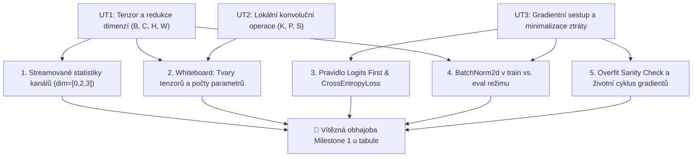
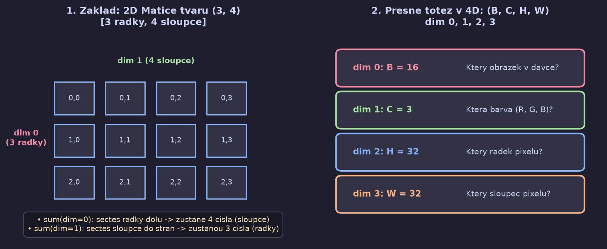
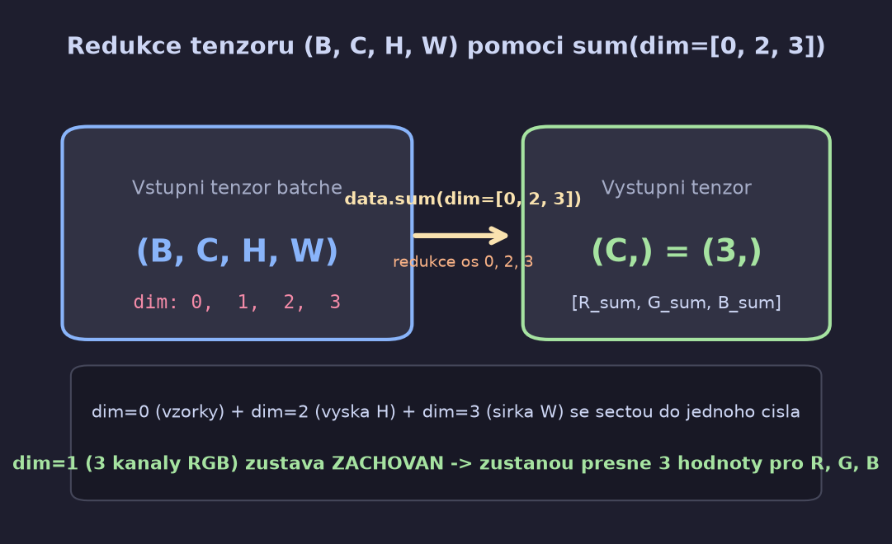
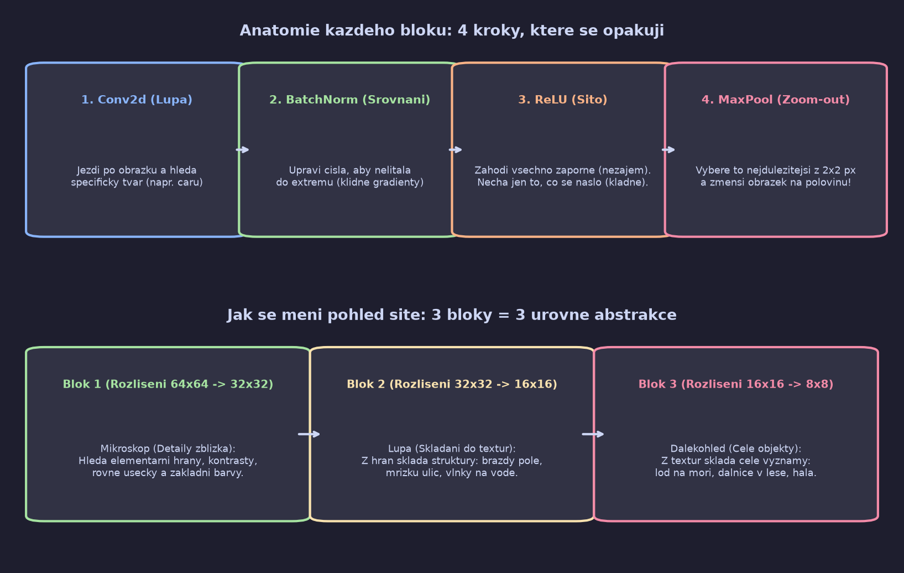
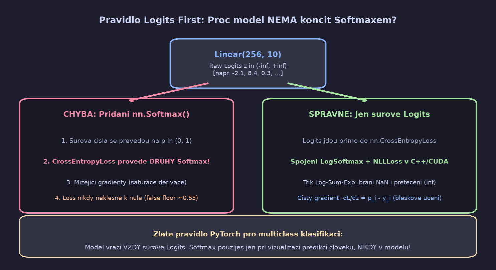
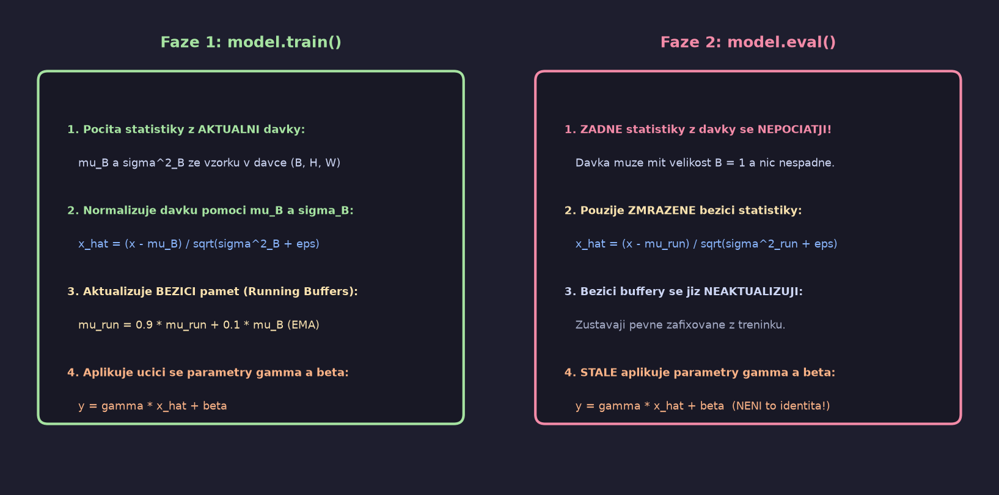
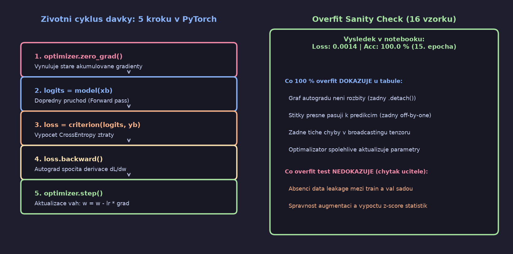

# 🎓 Interaktivní Tabule — Příprava na Obhajobu Milestone 1

Tento dokument slouží jako živá **tabule u obhajoby**. Zde budeme postupně krok za krokem zaznamenávat klíčové principy, whiteboard nákresy, odvození rozměrů tenzorů a otázky zkoušejícího, které musíš suverénně obhájit.

---

## 🗺️ Roadmapa témat (Dependency Graph)



### 📌 Stav jednotlivých uzlů:
* ✅ **Uzel 1: Streamovaný výpočet RGB statistik & Redukce dimenzí (`dim=[0, 2, 3]`)** — *DOKONČENO*
* ✅ **Uzel 2: Whiteboard Shape Defense & Výpočet parametrů** — *DOKONČENO*
* ✅ **Uzel 3: Pravidlo Logits First & CrossEntropyLoss (log-sum-exp)** — *DOKONČENO*
* ✅ **Uzel 4: BatchNorm2d v train vs. eval režimu** — *DOKONČENO*
* ✅ **Uzel 5: Overfit Sanity Check & Autograd životní cyklus** — *DOKONČENO*
* 🏆 **CÍL: Vítězná obhajoba Milestone 1 u tabule** — *PŘIPRAVENO K OBHAJOBĚ!*

---

## 📍 Uzel 1: Streamovaný výpočet RGB statistik & Redukce dimenzí (`dim=[0, 2, 3]`)

### 1. Motivace: Proč nemůžeme data načíst najednou?
Abychom satelitní snímky standardizovali pro konvoluční síť (Z-score normalizace), potřebujeme zjistit průměr ($\mu$) a směrodatnou odchylku ($\sigma$) pro každý ze 3 barevných kanálů (R, G, B) v trénovací sadě.
* **Naivní přístup (Eager Loading):** Načíst všech $18\,900$ snímků naráz do jednoho velkého tenzoru v RAM a zavolat `.mean()` a `.std()`.
* **Problém:** Spotřeba několika gigabajtů RAM $\to$ na větších datasetech okamžitý pád programu na **Out-of-Memory (OOM)**.
* **Řešení:** Čteme data z disku za běhu po malých dávkách (**Lazy Loading**) a statistiky počítáme **streamovaně**. Paměťová náročnost je konstantní: $\mathcal{O}(\text{batch}) \approx 3\text{ MB}$.

---

### 2. Nepodmíněná pravda: Co vlastně znamená „dimenze“ a jak funguje `sum(dim)`?

Vraťme se na úplný začátek k nejjednodušší představě, ze které všechno plyne.



#### Krok A: Začněme s obyčejnou tabulkou (2D matice) o rozměru `(3, 4)`
Máme tabulku, která má **3 řádky** a **4 sloupce**.
* `dim=0` představuje **řádky** (je jich 3).
* `dim=1` představuje **sloupce** (jsou 4).

Co se stane, když zavoláme sčítání podél dimenze?
1. **`matice.sum(dim=0)`**:
   * Sčítáme svisle přes všechny **řádky** (řádky se smrsknou do sebe).
   * Co zůstane? Zůstanou **sloupce**!
   * Výsledek má tvar `torch.Size([4])` (čtyři čísla, pro každý sloupec jeden součet).
2. **`matice.sum(dim=1)`**:
   * Sčítáme vodorovně přes všechny **sloupce** (sloupce se smrsknou do sebe).
   * Co zůstane? Zůstanou **řádky**!
   * Výsledek má tvar `torch.Size([3])` (tři čísla, pro každý řádek jeden součet).

> [!NOTE]
> **Základní pravidlo:**
> Kterou osu zadáš do `dim`, ta osa **zanikne (sečte se)**. Ostatní osy **přežijí**.

---

#### Krok B: Přechod do 4D pro satelitní snímky `(B, C, H, W)`
V PyTorch není 4D nic jiného než seznam tabulek:
$$\mathbf{X} \in \mathbb{R}^{B \times C \times H \times W}$$

Každé číslo v závorce má svůj pevný index (počítáno od nuly):
* `dim 0`: **$B$ (Batch)** — kolikátý je to obrázek (např. 16)
* `dim 1`: **$C$ (Channels)** — která je to barva: Red, Green, Blue (celkem 3)
* `dim 2`: **$H$ (Height)** — který řádek pixelů (např. 32)
* `dim 3`: **$W$ (Width)** — který sloupec pixelů (např. 32)

#### ⚠️ Nejčastější past u tabule: „Chci zachovat kanály“ vs. „Přes co průměruji“
Tady chybuje většina studentů. V běžné řeči totiž říkáme: *„Chci spočítat průměr pro kanály (dim 1).“*
A mozek má nutkání napsat `dim=[1]`. Jenže v PyTorch parametr `dim` neznamená *„koho chci nechat naživu“*, ale **„koho chci zničit (sečíst dohromady)“**!

Podívej se na ten kontrast:

| Co napíšeš do kódu | Co se stane v tenzoru | Kdo přežije (výsledný tvar) | Fyzikální význam |
| :--- | :--- | :--- | :--- |
| `x.mean(dim=[1])` | Zkolabuješ barvy (R + G + B se sečtou) | `torch.Size([16, 32, 32])` | Převedl jsi obrázky na **černobílé**! Zanikly barvy, zůstaly pixely. |
| `x.mean(dim=[0, 2, 3])` | Zkolabuješ obrázky, řádky i sloupce | `torch.Size([3])` | **Zachoval jsi 3 barvy!** Získal jsi průměr pro R, G a B. |

> [!CAUTION]
> ### 🧠 KLÍČOVÝ AHA-MOMENT: `dim` vs. myšlené `keep_dims`
>
> Lidský mozek uvažuje takto:
> * *„Chci, aby ve výsledku zůstaly dimenze 0 a 2 (tvar `(32, 64)`). Tak napíšu `dim=[0, 2]`!“*
>
> **Kdyby měl PyTorch parametr `keep_dims=[0, 2]`, měl bys 100% pravdu!**
> Jenže PyTorch takový parametr nemá. PyTorch má parametr `dim`, což je ve skutečnosti **`collapse_dim`** (co má zaniknout).
>
> | Co si přeješ ve výsledku | Které osy chceš ZACHOVAT | Kterou osu musíš ZNIČIT | Co MUSÍŠ napsat do PyTorch |
> | :--- | :--- | :--- | :--- |
> | Tvar `(3,)` (jen barvy) | Dimenzi 1 | Dimenze 0, 2, 3 | `x.mean(dim=[0, 2, 3])` |
> | Tvar `(32, 64)` (dávka a příznaky) | Dimenze 0 a 2 | Dimenzi 1 | `x.mean(dim=1)` |
> | Tvar `(64, 64)` (jen výška a šířka) | Dimenze 2 a 3 | Dimenze 0 a 1 | `x.mean(dim=[0, 1])` |

#### Co znamená `tensor.sum(dim=...)`? — Zlaté „Škrtací pravidlo“
Mnoho studentů si pamatuje jen konečný výsledek `(3,)`, ale u tabule dostanou jinou dimenzi a zaváhají. Přitom je to naprosto přímočaré:

> [!IMPORTANT]
> **Zlaté škrtací pravidlo pro `dim` v libovolném tenzoru:**
> 1. Napiš si indexy a jejich velikosti vedle sebe:
>    $$\text{dim 0} = B \,(64), \quad \text{dim 1} = C \,(3), \quad \text{dim 2} = H \,(64), \quad \text{dim 3} = W \,(64)$$
> 2. **Všechna čísla uvedená v `dim=[...]` jednoduše škrtni (tato čísla se sčítají/průměrují)!**
> 3. Ta čísla, která neškrtneš, tvoří přesný výsledný tvar tenzoru.

* **Příklad z notebooku:** `dim=[0, 2, 3]`
  * Škrtneme: $\cancel{0}, \cancel{2}, \cancel{3}$.
  * Zbyl index: $1$ (který má rozměr $3$).
  * Výsledek: `torch.Size([3])`.

* **Příklad z testu:** `dim=[0, 2]`
  * Škrtneme: $\cancel{0}, \cancel{2}$.
  * Zbyly indexy: $1$ (rozměr $3$) a $3$ (rozměr $64$).
  * Výsledek: `torch.Size([3, 64])` (pro každý kanál zůstal řádek se zprůměrovanými sloupci).



Když zavoláme:
```python
channels_sum += data.sum(dim=[0, 2, 3])
```
1. Sečteme pixely přes všechny obrázky v dávce (`dim=0`).
2. Sečteme pixely přes celou výšku $H$ (`dim=2`).
3. Sečteme pixely přes celou šířku $W$ (`dim=3`).
4. **Dimenzi 1 (kanály $C$) jsme vynechali!** Proto zůstane zachována.

Výsledkem je kompaktní 1D tenzor o velikosti **$(3,)$**, obsahující právě 3 čísla:
$$[\text{suma hodnot pro R}, \text{suma hodnot pro G}, \text{suma hodnot pro B}]$$

---

### 3. Matematický trik: Výpočet směrodatné odchylky na jeden průchod
Klasický vzorec pro rozptyl vyžaduje nejprve znát průměr $\mu$, a pak data projít podruhé:
$$\text{Var}(X) = \frac{1}{N} \sum (x_i - \mu)^2$$
My však data procházíme z disku jen **jednou**. Využíváme základní větu z teorie pravděpodobnosti:
$$\text{Var}(X) = \mathbb{E}[X^2] - (\mathbb{E}[X])^2$$

Během jednoho průchodu sčítáme:
1. Součet pixelů: `channels_sum += data.sum(dim=[0, 2, 3])`
2. Součet druhých mocnin: `channels_sq_sum += (data ** 2).sum(dim=[0, 2, 3])`

Po projití všech dávek spočítáme:
$$\mu = \frac{\sum X}{N_{\text{total}}}, \quad \sigma = \sqrt{\frac{\sum X^2}{N_{\text{total}}} - \mu^2}$$

V kódu:
```python
mean_rgb = channels_sum / total_pixels
std_rgb = torch.sqrt((channels_sq_sum / total_pixels) - (mean_rgb ** 2))
```

---

### 🎓 Whiteboard Defense Check: Jak by se zeptal učitel
> **Otázka zkoušejícího:**
> *"Proč máte v kódu při počítání průměru `data.sum(dim=[0, 2, 3])`? Proč tam není číslo 1 a proč je výsledek pole o třech prvcích?"*
>
> **Tvoje neprůstřelná odpověď:**
> *"Dávka má tvar $(B, C, H, W)$. Chceme spočítat statistiky nezávisle pro každý barevný kanál zvlášť. Číslo 1 odpovídá dimenzi kanálů $C$, kterou chceme zachovat. Čísla 0, 2 a 3 odpovídají dávce, výšce a šířce, přes které všechny pixely vysčítáme. Proto nám z $4\text{D}$ tenzoru zůstane $1\text{D}$ vektor se třemi hodnotami pro červený, zelený a modrý kanál."*


---

## 📍 Uzel 2: Whiteboard Shape Defense & Výpočet parametrů

### 1. Motivace: Proč tě zkoušející pošle k tabuli?
V zadání je explicitně uvedeno pravidlo **"The whiteboard / shape defense"**. Učitel chce okamžitě poznat, zda jsi síť jen bezmyšlenkovitě nezkopíroval z internetu nebo nenechal vygenerovat AI. U tabule ti smaže kód a řekne:
* *„Nakresli mi tabulku přechodů rozměrů tenzorů $(B, C, H, W)$ přes celou síť.“*
* *„Vysvětli mi lidskou řečí, co se fyzicky děje v každém bloku s obrazem.“*
* *„Spočítej z hlavy, kolik parametrů má vrstva `nn.Linear(8192, 256)` a kde leží většina vah modelu.“*
* *„Proč je bias v `Conv2d` zbytečný, když za ním následuje `BatchNorm2d`?“*



---

### 💡 Intuitivní průvodce sítí (Co se děje v každém bloku „jako pro člověka“)

Představ si, že dostaneš satelitní fotku $64 \times 64$ pixelů a máš zjistit, co na ní je.
Kdybys koukal na všech $64 \times 64 = 4\,096$ pixelů naráz jako na hromadu čísel, nic nepoznáš. Model `BaselineCNN` proto funguje jako **tým analytiků ve třech patrech budovy**, kde se v každém patře opakují přesně **4 stejné kroky**:

#### 🔄 Rytmus 4 kroků v každém bloku:
1. 🔍 **`Conv2d` (Hledáček / Razítko):**
   * Malé okénko $3 \times 3$ pixely jezdí po obrázku a hledá konkrétní vzor.
   * V bloku 1 máme 32 takových filtrů $\implies$ 32 různých hledačů (svislé čáry, vodorovné čáry, ostré rohy, barevné přechody).
   * Kde filtr najde shodu, zapíše vysoké kladné číslo (*„Tady to je!“*). Kde ne, zapíše záporné číslo (*„Tady nic není“*).
2. 🎚️ **`BatchNorm2d` (Srovnávač hlasitosti):**
   * Čísla z konvoluce by mohla divoce létat (např. od -300 do +500) a síť by se „překřičela“.
   * BatchNorm je zklidní: srovná průměr k 0 a rozptyl k 1. Tím zaručí klidné gradienty.
3. 🚪 **`ReLU` (Sítko na nezajímavosti):**
   * Pravidlo: `max(0, x)`.
   * Všechno záporné smaže na 0: *„Nenašel jsi tam nic? Nezájem, zahoď to.“*
   * Kladné nechá projít: *„Našel jsi tam hranu se silou 4.2? Skvělé, pošli to dál.“*
4. 🗜️ **`MaxPool2d(2, 2)` (Zmenšovací kopírka / Zoom-out):**
   * Rozdělí mapu na čtverečky $2 \times 2$ pixely.
   * Z každého vybere **pouze nejvyšší číslo** (nejdůležitější detail) a zbytek zahodí.
   * **Výsledek:** Zmenší výšku i šířku na polovinu ($64 \to 32 \to 16 \to 8$). Síť tak v dalším patře vidí mnohem větší kus krajiny naráz!

---

#### 🏢 Tři patra abstrakce (Od pixelu k významu):
* 🔬 **Blok 1 (Mikroskop — detaily zblízka):**
  * Zmenší prostor $64 \times 64 \to 32 \times 32$.
  * Hledá nejjednodušší věci: rovné linie, hrany polí, rohy domů, přechod modré a zelené.
* 🔍 **Blok 2 (Lupa — skládání textur):**
  * Zmenší prostor $32 \times 32 \to 16 \times 16$.
  * Ze základních hran skládá složitější struktury: čáry vedle sebe $\to$ **brázdy na poli**, mřížka čar $\to$ **uliční síť**, šedá rovná stuha $\to$ **asfalt dálnice**.
* 🔭 **Blok 3 (Dalekohled — hotové objekty):**
  * Zmenší prostor $16 \times 16 \to 8 \times 8$.
  * Z textur skládá sémantické celky: shluk střech a ulic $\to$ **Residential (město)**, jednolitá modř $\to$ **SeaLake (moře)**, zelené brázdy $\to$ **PermanentCrop (vinice/sady)**.

---

#### 🎯 Klasifikační hlava (Rozhodovací komise):
1. 📦 **`Flatten`:**
   * Po 3. bloku máme $128$ map o rozměru $8 \times 8$.
   * `Flatten` tuto 3D kostku vysype na stůl do jedné rovné řady čísel: $128 \times 8 \times 8 = \mathbf{8\,192}$ hodnot.
2. 🧠 **`Linear(8192, 256)`:**
   * Propojí všech 8 192 nalezených stop a vyhodnotí jejich souvislosti. Tady síť přemýšlí jako celek (proto je tu 95.6 % všech vah!).
3. 🎲 **`Dropout(0.3)`:**
   * Při tréninku náhodně vypne 30 % spojení, aby se model nespoléhal jen na pár konkrétních neuronů.
4. 🏁 **`Linear(256, 10)`:**
   * Vyplivne **10 konečných čísel (Logitů)** — jedno skóre pro každou z 10 tříd EuroSAT. Která třída má nejvyšší skóre, ta vyhrává.

---

### 2. Nepodmíněná pravda: Vzorec pro prostorový rozměr konvoluce
Pro jakoukoliv 2D konvoluci platí univerzální vztah:
$$W_{\text{out}} = \left\lfloor \frac{W_{\text{in}} - K + 2P}{S} \right\rfloor + 1$$

Kde:
* $W_{\text{in}}$ = vstupní prostorový rozměr (výška nebo šířka)
* $K$ = velikost jádra (`kernel_size`, např. $3$)
* $P$ = doplnění nulami (`padding`, např. $1$)
* $S$ = krok posunu (`stride`, např. $1$)

#### Proč naše konvoluce nemění prostorový rozměr ($64 \to 64$)?
Dosadíme naše hodnoty ($W_{\text{in}}=64, K=3, P=1, S=1$):
$$W_{\text{out}} = \left\lfloor \frac{64 - 3 + 2 \cdot 1}{1} \right\rfloor + 1 = \left\lfloor \frac{63}{1} \right\rfloor + 1 = 64$$
> [!TIP]
> **Pravidlo pro „Same“ padding:**
> Pokud zvolíš $K=3, P=1, S=1$, prostorový rozměr se **nikdy nezmění**!
> Teprve vrstva `MaxPool2d(kernel_size=2, stride=2)` rozměr **půlí** ($\lfloor \frac{64 - 2}{2} \rfloor + 1 = 32$).

---

### 3. Kompletní Whiteboard tabulka rozpadu sítě:

| Krok / Vrstva | Vstupní tvar `(B, C, H, W)` | Výstupní tvar `(B, C, H, W)` | Výpočet parametrů (vahami a biasy) | Počet vah |
| :--- | :--- | :--- | :--- | :--- |
| **Vstup** | `(B, 3, 64, 64)` | `(B, 3, 64, 64)` | Vstupní obrazový tenzor | $0$ |
| **Blok 1** | | | | |
| `Conv2d(3, 32, k=3, p=1)` | `(B, 3, 64, 64)` | `(B, 32, 64, 64)` | $32 \times (3 \times 3 \times 3) + 32$ | $896$ |
| `BatchNorm2d(32)` + `ReLU` | `(B, 32, 64, 64)` | `(B, 32, 64, 64)` | $2 \times 32$ ($\gamma$ a $\beta$) | $64$ |
| `MaxPool2d(2, 2)` | `(B, 32, 64, 64)` | `(B, 32, 32, 32)` | Bez parametrů (jen výběr maxima) | $0$ |
| **Blok 2** | | | | |
| `Conv2d(32, 64, k=3, p=1)` | `(B, 32, 32, 32)` | `(B, 64, 32, 32)` | $64 \times (32 \times 3 \times 3) + 64$ | $18\,496$ |
| `BatchNorm2d(64)` + `ReLU` | `(B, 64, 32, 32)` | `(B, 64, 32, 32)` | $2 \times 64$ ($\gamma$ a $\beta$) | $128$ |
| `MaxPool2d(2, 2)` | `(B, 64, 32, 32)` | `(B, 64, 16, 16)` | Bez parametrů | $0$ |
| **Blok 3** | | | | |
| `Conv2d(64, 128, k=3, p=1)`| `(B, 64, 16, 16)` | `(B, 128, 16, 16)` | $128 \times (64 \times 3 \times 3) + 128$ | $73\,856$ |
| `BatchNorm2d(128)` + `ReLU`| `(B, 128, 16, 16)`| `(B, 128, 16, 16)` | $2 \times 128$ ($\gamma$ a $\beta$) | $256$ |
| `MaxPool2d(2, 2)` | `(B, 128, 16, 16)`| `(B, 128, 8, 8)` | Bez parametrů | $0$ |
| **Klasifikační hlava** | | | | |
| `Flatten()` | `(B, 128, 8, 8)` | `(B, 8192)` | $128 \times 8 \times 8 = \mathbf{8\,192}$ | $0$ |
| `Linear(8192, 256)` + `ReLU` | `(B, 8192)` | `(B, 256)` | $8\,192 \times 256 + 256$ | **$2\,097\,408$** (🔥 95.6 %) |
| `Dropout(p=0.3)` | `(B, 256)` | `(B, 256)` | Bez parametrů (náhodné nulování) | $0$ |
| `Linear(256, 10)` | `(B, 256)` | `(B, 10)` | $256 \times 10 + 10$ | $2\,570$ |
| **CELKEM** | | | Všechny trénovatelné váhy | **$2\,193\,674$** |

---

### 4. Dva těžké chytáky pro obhajobu u tabule:

#### Chyták 1: Odkud se vzalo číslo $2\,097\,408$ u `Linear(8192, 256)`?
Vzorec pro plně propojenou vrstvu (`Linear`):
$$\text{Params} = (C_{\text{in}} \cdot C_{\text{out}}) + C_{\text{out}} = C_{\text{out}} \cdot (C_{\text{in}} + 1)$$
* $C_{\text{in}} = 8\,192$ (přišlo z $128 \text{ kanálů} \times 8 \times 8 \text{ pixelů}$)
* $C_{\text{out}} = 256$
* Váhová matice: $8\,192 \times 256 = 2\,097\,152$ vah
* Vektor biasů: $+ 256$
* Celkem: **$2\,097\,408$ parametrů**!
> **Závěr pro obhajobu:** Plně propojená vrstva spotřebuje **95.6 % paměti celého modelu**, zatímco všechny konvoluce dohromady tvoří jen cca 4 %!

#### Chyták 2: Redundance biasu v `Conv2d` před `BatchNorm2d`
Zkoušející se tě může zeptat: *„Máte v `Conv2d` zapnutý `bias=True`? Vadí to něčemu?“*
Matematické odvození:
1. Konvoluce spočítá lineární kombinaci s biasem:
   $$Z = WX + b$$
2. Následující `BatchNorm2d` spočítá průměr dávky:
   $$\mu_B = \text{mean}(WX + b) = \text{mean}(WX) + b$$
3. Při normalizaci se průměr odečte:
   $$\hat{Z} = \frac{Z - \mu_B}{\sqrt{\sigma^2 + \epsilon}} = \frac{(WX + b) - (\text{mean}(WX) + b)}{\sqrt{\dots}} = \frac{WX - \text{mean}(WX)}{\sqrt{\dots}}$$
**Bias $b$ se v čitateli přesně odečte a zruší!**
`BatchNorm2d` má navíc svůj vlastní naučitelný posun $\beta$. Proto je bias v konvoluci před BatchNormem zbytečný výpočetní balast. (V čistém kódu se proto píše `nn.Conv2d(..., bias=False)`).


---

## 📍 Uzel 3: Pravidlo „Logits First“ & CrossEntropyLoss (log-sum-exp)

### 1. Motivace: Záhada chybějícího Softmaxu
Podívej se na úplný konec naší sítě `BaselineCNN`:
```python
self.classifier = nn.Sequential(
    nn.Linear(128 * 8 * 8, 256),
    nn.ReLU(),
    nn.Dropout(p=0.3),
    nn.Linear(256, 10),  # <--- Tady síť končí! Kde je Softmax?!
)
```
Každý student se zeptá: *„Máme 10 tříd. Jak to, že na konci sítě nemáme `nn.Softmax()`, aby nám lezly pravděpodobnosti od 0 do 1?“*

A zkoušející u tabule se zeptá ještě záludněji:
*„Co by se stalo, kdybyste tam ten Softmax přidali?“*



---

### 2. Nepodmíněná pravda: Co je to Logit?
* **Logit ($z$):** Surové, nijak neohraničené skóre, které vypadne z lineární vrstvy `Linear(256, 10)`. Může to být jakékoliv reálné číslo: $-50$, $0$, $+12.4$ atd.
* **Pravděpodobnost ($p$):** Číslo ostře sevřené v intervalu $[0, 1]$, přičemž součet přes všech 10 tříd musí dát přesně $1.0$ ($100\,\%$).

Naivní myšlenka říká:
1. Převeďme logity $z$ na pravděpodobnosti pomocí Softmaxu:
   $$p_i = \frac{e^{z_i}}{\sum_{j=1}^C e^{z_j}}$$
2. Spočtěme záporný logaritmus pravděpodobnosti správné třídy $y$ (tzv. NLLLoss):
   $$\mathcal{L} = -\log(p_y) = -\log\left(\frac{e^{z_y}}{\sum e^{z_j}}\right)$$

---

### 3. Proč naivní cesta v počítači zkolabuje (Numerická katastrofa)
Počítače počítají ve 32bitové plovoucí řádové čárce (`float32`). A ta má přísné fyzikální limity:
* **Přetečení (Overflow):** Číslo $e^{89} \approx 2.4 \times 10^{38}$, což je absolutní strop `float32`. Pokud ti z lineární vrstvy vypadne logit $z = 90$, $e^{90} = \mathbf{+\infty}$ (inf). Výpočet zkolabuje na `NaN` (Not a Number).
* **Podtečení (Underflow):** Pokud ti vypadnou velká záporná čísla (např. $z = -100$), $e^{-100} = 0.0$. Jmenovatel se stane nulou $\to$ dělení nulou nebo $\log(0) = -\infty \to \mathbf{NaN}$.

---

### 4. Matematický trik Log-Sum-Exp (LSE) — Záchrana v PyTorch
Ztrátová funkce `nn.CrossEntropyLoss` v PyTorch **neočekává pravděpodobnosti, ale surové logity**.
Uvnitř v sobě totiž v jediném rychlém C++/CUDA jádře spojuje Softmax i Logaritmus dohromady pomocí elegantního matematického triku:

Rozepíšeme logaritmus podílu:
$$\mathcal{L} = -\log\left(\frac{e^{z_y}}{\sum e^{z_j}}\right) = -z_y + \log\left(\sum_{j=1}^C e^{z_j}\right)$$

Označme $M = \max(z)$ (nejvyšší logit v vektoru). Vytkneme $e^M$:
$$\sum e^{z_j} = \sum e^{z_j - M + M} = e^M \sum e^{z_j - M}$$

Zlogaritmujeme:
$$\log\left(\sum e^{z_j}\right) = \log\left(e^M \sum e^{z_j - M}\right) = M + \log\left(\sum_{j=1}^C e^{z_j - M}\right)$$

Dosadíme zpět do ztráty:
$$\mathbf{\mathcal{L} = -z_y + M + \log\left(\sum_{j=1}^C e^{z_j - M}\right)}$$

> [!TIP]
> **Proč je tento vzorec absolutně nezničitelný?**
> 1. Protože od každého $z_j$ odečítáme maximum $M$, je exponent $z_j - M \le 0$. Exponenciála $e^{\le 0}$ je v rozmezí $(0, 1]$. **Nikdy nepřeteče do nekonečna!**
> 2. Pro nejvyšší logit platí $M - M = 0$, takže $e^0 = 1$. Součet je tedy vždy $\ge 1$, a logaritmus $\log(\ge 1) \ge 0$. **Nikdy nepodteče k nule ani k $-\infty$!**

---

### 5. Co se stane, když student přidá `nn.Softmax()` na konec sítě?
Tohle je absolutně nejčastější past u obhajoby! Zkoušející se tě zeptá: *„A spadne ten kód, když tam ten Softmax přidáte?“*

> [!CAUTION]
> **POZOR: PyTorch NEVYHODÍ ŽÁDNOU CHYBU! Kód nespadne!**
> Proč? Protože:
> * Surové logity mají tvar `(64, 10)` a typ `torch.float32`.
> * Výstup ze Softmaxu má tvar `(64, 10)` a typ `torch.float32`.
> 
> Z pohledu PyTorchu do funkce vstupují rozměrově i typově naprosto v pořádku tenzory. PyTorch neví, že jsi tam Softmax dal omylem. Kód **tiše a bez varování běží dál** — a to je na tom to nejnebezpečnější (tzv. *tichý matematický bug*).

#### Co se stane v matematice sítě za běhu:
1. **Dvojitý Softmax:**
   `nn.CrossEntropyLoss` předpokládá, že dostala surová neohraničená čísla, takže na tvoje již normalizované pravděpodobnosti z intervalu $[0, 1]$ pustí **druhý Softmax a logaritmus**.
2. **Mizející gradienty (Vanishing Gradients):**
   Derivace přidaného Softmaxu se v řetízkovém pravidle násobí s gradientem. Pro jisté predikce je tato derivace téměř nulová. Gradienty vymizí a model se přestane učit.
3. **Ztráta nikdy neklesne k nule (Falešné dno ztráty):**
   I kdyby model předpověděl správnou třídu se 100% jistotou ($p = [1.0, 0.0, 0.0]$ pro 3 třídy), `CrossEntropyLoss` z toho spočítá:
   $$\mathcal{L} = -\log\left(\frac{e^1}{e^1 + e^0 + e^0}\right) = -\log\left(\frac{e}{e + 2}\right) \approx \mathbf{0.551 \neq 0}$$
   Ztráta nemůže nikdy klesnout k nule a trénování je znehodnocené!

---

### 🎓 Whiteboard Defense Shrnutí:
> * **Zlaté pravidlo PyTorch:** Modely pro klasifikaci končí **VŽDY surovými logity (`Linear`)**.
> * `nn.CrossEntropyLoss` očekává surové logity a interně provádí numericky stabilní `LogSoftmax + NLLLoss`.
> * Softmax použijeme **POUZE** tehdy, když chceme výsledky vytisknout člověku v procentech (např. při vizualizaci predikcí v sekci 8).


---

## 📍 Uzel 4: BatchNorm2d v train vs. eval režimu (Záhada přepínání režimů)

### 1. Motivace: Proč v kódu píšeme `model.train()` a `model.eval()`?
V naší trénovací smyčce (sekce 7 v notebooku) najdeš tyto dva příkazy:
* Před trénováním: `model.train()`
* Před validací a testováním: `model.eval()`

Spousta studentů si myslí: *„`eval()` znamená evaluovat, takže se vrstvy jako BatchNorm a Dropout jednoduše vypnou a data jimi projdou beze změny jako vzduchem.“*
**U Dropoutu je to pravda, ale u BatchNormu je to FATÁLNÍ OMYL!**



---

### 2. Nepodmíněná pravda: Dvě vrstvy, které mění své chování

| Vrstva | Co dělá v `model.train()` | Co dělá v `model.eval()` |
| :--- | :--- | :--- |
| **`nn.Dropout(p=0.3)`** | **Náhodně maže 30 % neuronů** na nulu (zabraňuje přetrénování). | **VYPNE SE.** Všechny neurony projdou beze změny (násobeny 1.0). Zde je to skutečně identita. |
| **`nn.BatchNorm2d(C)`** | **Počítá statistiky z aktuální dávky** a ukládá si dlouhodobý klouzavý průměr. | **NEVYPÍNÁ SE!** Přepne se na používání **naučené dlouhodobé paměti**. |

---

### 3. Jak přesně funguje `BatchNorm2d` v `model.train()`:
Při trénování přichází tenzor dávky $X \in \mathbb{R}^{B \times C \times H \times W}$.
Pro každý kanál $c$ BatchNorm provede:

1. **Spočítá průměr a rozptyl z AKTUÁLNÍ DÁVKY:**
   $$\mu_B = \frac{1}{B \cdot H \cdot W} \sum X, \quad \sigma_B^2 = \frac{1}{B \cdot H \cdot W} \sum (X - \mu_B)^2$$
2. **Normalizuje aktuální dávku:**
   $$\hat{X} = \frac{X - \mu_B}{\sqrt{\sigma_B^2 + \epsilon}}$$
3. **Uloží si to do „dlouhodobé paměti“ (Running Buffers) pomocí exponenciálního průměru:**
   $$\mu_{\text{run}} \leftarrow 0.9 \cdot \mu_{\text{run}} + 0.1 \cdot \mu_B$$
   $$\sigma^2_{\text{run}} \leftarrow 0.9 \cdot \sigma^2_{\text{run}} + 0.1 \cdot \sigma_B^2$$
4. **Přeladí rozsah pomocí naučitelných parametrů $\gamma$ (měřítko) a $\beta$ (posun):**
   $$Y = \gamma \hat{X} + \beta$$

---

### 4. Co se děje v `model.eval()` — Proč to NENÍ identita?
Při validaci nebo testování **je zakázáno počítat statistiky z aktuální dávky**. 
Proč? Protože při nasazení v praxi může do modelu přijít **jeden jediný satelitní snímek ($B=1$)**. Z jednoho obrázku nelze spočítat smysluplný rozptyl dávky!

V režimu `eval()` proto BatchNorm:
1. **Zcela vypne počítání $\mu_B$ a $\sigma_B^2$** z dávky.
2. Místo toho vezme své **zmrazené běžící statistiky ($\mu_{\text{run}}, \sigma^2_{\text{run}}$)**, které si nasbíral během celého tréninku:
   $$\hat{X} = \frac{X - \mu_{\text{run}}}{\sqrt{\sigma^2_{\text{run}} + \epsilon}}$$
3. A stále na ně aplikuje parametry $\gamma$ a $\beta$:
   $$Y = \gamma \hat{X} + \beta$$

> [!IMPORTANT]
> **Proč to NENÍ identita ($Y \neq X$)?**
> Protože data jsou stále posouvána a škálována fixní afinní transformací! V evaluaci se z BatchNormu stane jednoduchá deterministická rovnice přímky:
> $$Y = W_{\text{fused}} X + B_{\text{fused}}$$
> Každý vstupní pixel je znormalizován podle celkové globální statistiky trénovacího datasetu.

---

### 🎓 Dva vražedné chytáky zkoušejícího u tabule:

#### Chyták 1: *„Co se stane, když budete chtít otestovat 1 satelitní snímek ($B=1$), ale zapomenete zavolat `model.eval()`?“*
* **Odpověď:** V `train()` režimu se BatchNorm pokusí spočítat rozptyl přes vzorky v dávce. Pro $B=1$ a prostorové pixely se data začnou normalizovat sama podle sebe, nebo při $1 \times 1$ dojde k dělení nulou. Model začne vracet naprosté nesmysly nebo `NaN`. Jakmile přepneš na `model.eval()`, model použije globální statistiky $\mu_{\text{run}}$ a i jediný snímek vyhodnotí naprosto spolehlivě!

#### Chyták 2: *„Proč by se testovací přesnost měnila podle toho, jestli testovací dávka má velikost 16 nebo 64, kdybyste zapomněli `model.eval()`?“*
* **Odpověď:** V `train()` režimu se obrázky v dávce navzájem ovlivňují, protože sdílejí společný průměr $\mu_B$. Predikce jednoho snímku by závisela na tom, jaké další snímky s ním zrovna náhodou sedí v dávce! V `eval()` režimu jsou statistiky fixní a každý snímek je vyhodnocen 100% nezávisle na ostatních.


---

## 📍 Uzel 5: Overfit Sanity Check & Autograd životní cyklus (Trénovací smyčka)

### 1. Motivace: Proč zadání vyžaduje „The Overfit Sanity Check“ (Krok 1.4)?
Představ si, že spustíš trénování na všech 18 900 snímcích na 20 epoch. Běží to 10 minut, a na konci je přesnost 10 % (náhodné hádání).
Kde je chyba? V datech? V architektuře? V učícím poměru? Nebo v samotné smyčce?
Nevíš.

Proto profesionální ML inženýři dělají **Overfit Sanity Check**:
1. Vezmeme mikrodávku pouhých **16 snímků**.
2. Pustíme na nich 40 epoch.
3. **Požadavek:** Ztráta MUSÍ spadnout k nule ($\text{Loss} \approx 0.00$) a přesnost MUSÍ vyletět na **$100.0\,\%$**.

Pokud to síť nedokáže, je v kódu fatální inženýrská chyba a nemá smysl pouštět plný trénink.
* **Náš výsledek v notebooku:** V 15. epoše přesnost $100.0\,\%$, konečná ztráta $0.0014$.



---

### 2. Pět kanonických kroků trénovací iterace v čistém PyTorch:
Zadání zakazuje jakékoliv nadstavby typu PyTorch Lightning. Každý řádek smyčky píšeme ručně:

```python
optimizer.zero_grad()  # 1. Vynulování starých gradientů
logits = model(xb)  # 2. Dopředný průchod (Forward pass)
loss = criterion(logits, yb)  # 3. Výpočet ztrátové funkce (CrossEntropy)
loss.backward()  # 4. Zpětný průchod (Autograd spočítá dLoss/dw)
optimizer.step()  # 5. Aktualizace vah sítě
```

---

### 3. Tři klíčové otázky k trénovací smyčce u tabule:

#### Otázka 1: *„Proč musíme volat `optimizer.zero_grad()`? Proč PyTorch gradienty nemaže automaticky?“*
* **Odpověď:** PyTorch gradienty v tenzorech parametrů `param.grad` ve výchozím nastavení **akumuluje (sčítá)**:
  $$g_{\text{celk}} = g_{\text{minulé}} + g_{\text{nové}}$$
  * **Kdybychom `zero_grad()` nezavolali:** Gradienty by s každou dávkou nekontrolovaně rostly, krok optimalizátoru by vybuchl a váhy by ulétly do `NaN`.
  * **Proč to tak PyTorch dělá?** Je to záměrná funkce pro tzv. *Gradient Accumulation*. Pokud máš malou grafickou kartu a nevejde se ti do paměti dávka 256 vzorků, můžeš poslat 4 dávky po 64, nechat gradienty sečíst, a `optimizer.step()` zavolat až po 4. dávce. Simuluješ tím velkou dávku na malé paměti!

#### Otázka 2: *„Proč při počítání ztráty v epoše násobíte `loss.item() * xb.size(0)`?“*
```python
running_train_loss += loss.item() * batch_size
```
* **Odpověď:** Protože poslední dávka v datasetu nemusí mít plnou velikost 64 vzorků (např. má jen 28 vzorků). Kdybychom jen sčítali průměry dávek `loss.item()` a na konci vydělili počtem dávek, malá dávka s 28 vzorky by měla stejnou váhu jako velká dávka se 64 vzorky. Násobením skutečnou velikostí dávky `xb.size(0)` a následným vydělením celkovým počtem vzorků získáme **přesný vážený průměr**.

#### Otázka 3: *„Co přesně Overfit Sanity Check DOKAZUJE a co naopak NEDOKAZUJE?“*
* **Co DOKAZUJE:**
  1. Graf autogradu není přerušený (žádné nechtěné volání `.detach()` nebo `.numpy()`).
  2. Indexy štítků přesně sedí na výstupní logity (žádný posun o 1, např. 1–10 místo 0–9).
  3. Nedochází k tichému roztažení tenzorů (*broadcasting bug*).
  4. Model má dostatečnou kapacitu si zapamatovat komplexní data.
* **Co NEDOKAZUJE (Past učitele!):**
  * Nedokazuje, že nemáme únik dat (*data leakage*) mezi train a val sadou.
  * Nedokazuje správnost augmentací ani Z-score standardizace.
  * Nedokazuje schopnost generalizace na neznámá data.

---

### 4. Checkpointing: Záchrana před přetrénováním (`best_baseline.pt`)
Naše síť se trénovala 12 epoch:
* Trénovací ztráta plynule klesala celých 12 epoch ($0.3099$).
* Validační ztráta dosáhla minima v **10. epoše ($0.2680$, Acc: $90.56\,\%$)**, ale v 11. a 12. epoše začala mírně stoupat (náznak lehkého přetrénování).
* Díky checkpointingu:
  ```python
  if val_loss < best_val_loss:
    best_val_loss = val_loss
    torch.save(model.state_dict(), "best_baseline.pt")
```
  jsme na konci načetli váhy z **10. epochy**, takže na testovací sadu šel model na svém absolutním vrcholu schopnosti zobecnění!


---

## 📍 Sekce 8 & 9: Finální evaluace, Analýza chyb & Obhajoba u tabule

### 1. Rekapitulace výsledků modelu BaselineCNN na testovací sadě:
Model byl vyhodnocen na **2 700 neviděných snímcích**:
* **Test Accuracy:** **`91.11 %`**
* **Test Loss:** **`0.2709`**
* **Makro F1-Score:** **`0.9087`**

#### 🏆 Nejúspěšnější třídy (F1 $\ge$ 95 %):
1. **`Residential` (F1: 98.0 %):** Velmi specifická textura uliční sítě a červených střech domů.
2. **`Forest` (F1: 96.2 %, Precision: 100.0 %):** Žádný jiný snímek nebyl označen za les (100% čistota predikcí).
3. **`SeaLake` (F1: 95.3 %):** Typická jednolitá tmavě modrá barva vodní plochy.

---

### 2. Kde vznikaly chyby a proč (Zlatý hřeb obhajoby):
Zkoušející se tě téměř jistě zeptá: *„Kde váš model chyboval a proč zrovna tam?“*
Ukážeš mu **konfuzní matici** a vysvětlíš tyto 3 fyzikální dvojice:

1. 🛣️🌊 **`Highway` (Dálnice) vs. `River` (Řeka):**
   * **Problém:** Model označil některé dálnice za řeky.
   * **Proč:** V nízkém rozlišení $64 \times 64$ px mají obě kategorie charakter **úzké, dlouhé, klikaté linie protínající krajinu**. Pokud má řeka vyschlé koryto nebo dálnice vede lesem, jejich textura je pro konvoluci téměř nerozeznatelná.
2. 🌾🌿 **`Pasture` (Pastvina) vs. `HerbaceousVegetation` (Bylinná vegetace):**
   * **Problém:** Vzájemná záměna travnatých ploch.
   * **Proč:** Obě kategorie sdílejí totožnou zelenou barvu a hladkou texturu. Rozdíl mezi loukou spásanou dobytkem a volnou bylinnou vegetací je často nejednoznačný i pro lidského botanika.
3. 🍇🌽 **`PermanentCrop` (Trvalé kultury / Sady) vs. `AnnualCrop` (Jednoroční plodiny / Pole):**
   * **Problém:** Záměna zemědělské půdy.
   * **Proč:** Ovocné sady a vinice (*PermanentCrop*) mají stejné rovnoběžné brázdy a linie výsadby jako běžná zoraná orná půda (*AnnualCrop*).

---

## 🏆 Rychlý checklist odpovědí k tabuli (Whiteboard Cheat-Sheet)

1. **Lazy Loading:** `Dataset` v RAM drží jen cesty. Snímky načítá z disku až metoda `__getitem__`.
2. **Streaming statistiky:** Vzorec $\sigma = \sqrt{\mathbb{E}[X^2] - (\mathbb{E}[X])^2}$ spočítá mean a std po dávkách bez přetížení RAM.
3. **Redukce dimenzí:** V `tensor.sum(dim=[0, 2, 3])` vyjmenováváme osy, které **chceme sečíst (zničit)**, aby zůstala dimenze 1 (kanály).
4. **Rozměry konvoluce:** Vzorec $W_{\text{out}} = \lfloor \frac{W_{\text{in}} - K + 2P}{S} \rfloor + 1$. Při $K=3, P=1, S=1$ se prostorový rozměr nemění ($64 \to 64$).
5. **Kde leží váhy:** $95.6\,\%$ všech vah leží v první vrstvě `Linear(8192, 256)` ($8\,192 \times 256 + 256 = 2\,097\,408$ vah) kvůli zploštění $128 \times 8 \times 8$.
6. **Bias v konvoluci:** Před `BatchNorm2d` je zbytečný (`bias=False`), protože BatchNorm odečítá průměr $\mu_B$, čímž se konstanta $b$ přesně vyruší.
7. **Logits First:** Model nevrací Softmax, ale surové logity. `nn.CrossEntropyLoss` interně provádí `LogSoftmax + NLLLoss` pomocí stabilního triku `Log-Sum-Exp`.
8. **Softmax bug:** Přidání Softmaxu do modelu nezpůsobí pád kódu (tvary tenzorů sedí), ale způsobí mizející gradienty a ztráta nikdy neklesne k nule.
9. **BatchNorm v eval():** Nevypíná se! Přepne se na používání zmrazených běžících statistik ($\mu_{\text{run}}, \sigma^2_{\text{run}}$) z tréninku a stále aplikuje $\gamma$ a $\beta$.
10. **Overfit Sanity Check:** 100% úspěch na 16 vzorcích dokazuje správnost autogradu, toku gradientů a shodu štítků bez broadcasting bugů.
